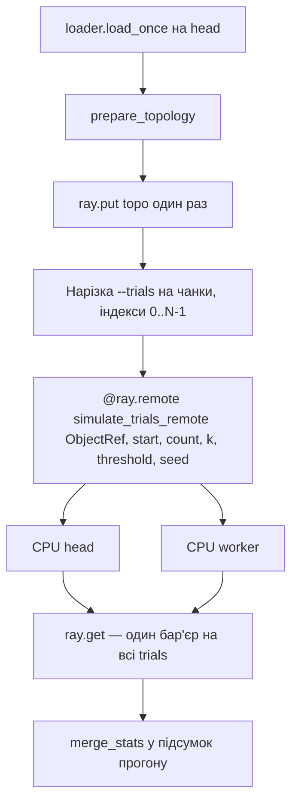

# PLAN2 — Етап 2: IEEE-118 Monte Carlo на Ray (1 head + 1 worker)

Статус: **v2 APPROVED**. Код у `source/ray-grid/`. Термінал, `pip`, `ray`, `git` — після **APPROVE CODE**.

Кластер цієї роботи: **1 head + 1 worker** (2 вузли Alive). Той самий розмір, що вже піднятий для нейтронного прогону.

Джерела:

- `@cloud_grid/docs/n01_power_grid_project.md` — §3 «Етап 2» (Ray tasks, `ray.put(topology)`, звіт throughput);
- `@cloud_grid/docs/p02_ray_grid.md` — CLI і форма метрик нейтронного Ray-кластера;
- `@cloud_grid/source/ray-grid/run.py`, `@cloud_grid/source/ray-grid/engine.py` — зразок команд `head` / `client` / `load` / `local` / `status` / `stop`;
- `@my-grid-lab/docs/work/PLAN.md` і `@my-grid-lab/source/grid-mimd/engine.py` — ядро каскаду етапу 1;
- здача цієї роботи: консоль `source/ray-grid/run.py`, без веб-інтерфейсу.

n01 називає каталог `source/grid-ray/`. Здача цієї роботи вимагає `source/ray-grid/`. Беремо ім'я зі здачі.

---

## 0. Що змінюється відносно етапу 1

| | Етап 1 `source/grid-mimd/` | Етап 2 `source/ray-grid/` |
| :--- | :--- | :--- |
| Де рахується | 1 ПК, `multiprocessing.Pool` | head + worker у LAN, Ray tasks |
| Хто читає `.mat` | батьківський процес один раз | **лише head, один раз** |
| Що бачить воркер | pickled `topo` в кожному аргументі чанка; імпорт модуля тягне завантажувач | готовий `topo` з object store (`ray.put` один раз) |
| Бекенди | лише `Pool` | `pool`, `numpy`, `ray` |
| Обсяг прогону | `--trials` (звіт: 10 000), один `Pool.map` | той самий `--trials`, один `ray.get` / `Pool.map` |
| Вихід | `benchmark_results_mimd_grid.json`, `speedup.png` | `benchmark_results_ray_grid.json`, `REPORT.md` |

`source/grid-mimd/` не змінюємо. Результати етапу 1 лишаються еталоном ядра.

Фізика та сама, що в PLAN.md §3–§7: ємність `lr <= 0` — `m·|P_ij|` (`m = 2.0`); шок `weighted`; TRIP — одна найгірша лінія за крок каскаду; seed trial `i` = `base_seed * 1_000_003 + i`. `MAX_STEPS = 186` лишається внутрішнім лімітом одного trial. Окремого прапорця `--steps` у CLI немає.

---

## 1. Рішення

Нижче зафіксовано варіант, з яким писати код після APPROVE PLAN. Інші варіанти лишаються в таблиці як відхилені.

### 1.1. Де лежить код

| Варіант | Плюс | Мінус |
| :--- | :--- | :--- |
| **A. `my-grid-lab/source/ray-grid/`** | Збігається з текстом здачі і з `@cloud_grid/source/ray-grid/` | Ім'я розходиться з n01 (`source/grid-ray/`) |
| B. `my-grid-lab/source/grid-ray/` | Буквально n01 | Здача просить `source/ray-grid/run.py` |

Пропозиція: **A**. У README один рядок, що це етап 2 з n01.

### 1.2. Хто завантажує датасет

Зараз `@my-grid-lab/source/grid-mimd/engine.py` на імпорті робить `sys.path.insert` у `cloud_grid/source/dataset_scripts` і `from load_powergraph_cascades import ...`. `load_scenario()` справді читає `.mat` один раз у батька. На Windows `Pool` стартує через `spawn`: кожен процес заново імпортує `engine`, тобто заново імпортує завантажувач (scipy, h5py, шлях до скриптів курсу). Сам `.mat` воркер не відкриває, але без цього імпорту модуль не піднімається.

На Ray-воркері цього шляху немає. Імпорт `engine` впаде до першого trial, навіть якщо батько вже поклав топологію в аргумент.

Друге: `_tasks()` кладе весь `topo` у кожен чанк. Для `Pool` це ~9 КБ локального pickle (етап 1: `topology_pickle_bytes = 9021`). Для Ray це окрема копія в object store на кожну задачу. n01 просить виміряти передачу топології через **один** `ray.put(topology)`.

| Варіант | Плюс | Мінус |
| :--- | :--- | :--- |
| **A. Head читає `.mat` один раз, `ray.put(topo)` один раз, воркер отримує `ObjectRef`** | Воркер не імпортує завантажувач і не бачить `.mat`. Один об'єкт у Plasma на весь прогін. Прямо n01 п.3 | `Pool` так не вміє: локальним бекендам `topo` все одно їде в аргументі чанка (об'єкт уже в пам'яті батька) |
| B. Той самий dict у кожному `remote(...)` | Менше коду, як нейтронні чанки | N копій одного й того самого `topo`; n01 просить один `put` |
| C. Кожен воркер сам викликає `load_powergraph_cascades` | — | Саме цей принцип прибираємо. На другій машині немає датасету |

Пропозиція: **A**.

Наслідки для модулів:

- `engine.py` не імпортує `load_powergraph_cascades`, scipy, h5py. Його можна імпортувати на воркері.
- `loader.py` імпортує скрипти датасету **всередині функції**, не на рівні модуля. Його викликає лише `run.py` на head у командах `load` і `local`.
- У object store кладемо вже зібраний dict `prepare_topology` (plain lists), не об'єкт PowerGraph. Еталон `dns_MW` / `output_features` лишається на head і пишеться в JSON.

Локальні `pool` і `numpy` теж беруть цей dict з пам'яті head. Повторного читання `.mat` немає. `Pool` передає dict у аргументі чанка: 9 КБ, процес уже на тій самій машині. Окремий `initializer` із глобальним `topo` не робимо — з'являється прихований стан процесу, а виграш на 9 КБ не вимірюється.

Код ядра (`prepare_topology`, `run_trial`, `simulate_trials_chunk`, `merge_stats`) живе в `ray-grid/engine.py` копією з `grid-mimd/engine.py`, без правок алгоритму. Спільний імпорт `grid-mimd.engine` на воркері знову потягне завантажувач. Розходження копій фіксується перевіркою §8: ті самі цілі лічильники, що етап 1, на `N = 10 000`, `k = 1`, `s = 83810`, `seed = 42`.

### 1.3. Обсяг прогону — `--trials`

Нейтронний `--steps` сюди не переноситься. У каскаді немає тіку реактора: один trial вже крутить власний цикл до `MAX_STEPS = 186`. Обсяг роботи задає `--trials`, як у PLAN.md §8.

Один виклик `load` — один прогін на всі `N` trials:

- індекси `0 … N-1`, seed trial `i` = `base_seed * 1_000_003 + i`;
- нарізка чанків як у етапі 1: `n_chunks = min(N, n_slots * 4)` (`CHUNKS_PER_WORKER = 4`);
- один бар'єр на весь прогін: `Pool.map` або `ray.get`;
- `n_slots = 1` — без пулу, один чанк у процесі head.

`n_slots`: для `pool` / `numpy` — `--workers` або `cpu_count()` head; для `ray` — сума CPU кластера, якщо `--workers` не заданий. Число процесів `Pool` дорівнює `n_slots`.

| | Default | Прогін звіту |
| :--- | ---: | ---: |
| `--trials` | `1000` | `10000` (PLAN.md §8, той самий `N`, що `benchmark_results_mimd_grid.json`) |

Пресетів `lab` / `control` немає: у нейтронах вони задавали число частинок на крок. Тут ту саму роль виконує `--trials`. На етапі 1 `N = 10 000` триває ~0.45 с на одному ядрі, тож рядок `ray` може складатися переважно з RPC. Більший обсяг — той самий прапорець, наприклад `--trials 100000`, без інших режимів.

### 1.4. Бекенд `numpy`

Модель каскаду гілляста: сусіди лінії — рваний список, TRIP залежить від попереднього кроку. Повний SIMD-перепис змінить порядок `random` і розійдеться з етапом 1.

| Варіант | Плюс | Мінус |
| :--- | :--- | :--- |
| **A. Той самий RNG і те саме правило TRIP; `flow` / `capacity` / `active` — `ndarray`; пошук перевантаження — маска** | Цілі лічильники збігаються з `pool`. У таблиці є третій рядок, як у здачі | Приріст може бути близький до нуля: цикл trial лишається Python. Це нормальний результат для звіту |
| B. Інший генератор (`numpy` RNG) і пакет trials | Може бути швидше | Інші блекаути. Порівнювати з етапом 1 і з `pool` не можна |
| C. Не робити `numpy`, у `--compare` лишити два рядки | Менше коду | Команда здачі перелічує три бекенди |

Пропозиція: **A**. `pool` лишає списки з етапу 1. Обидва локальні бекенди йдуть через один `multiprocessing.Pool` на **head**. Підключений worker у `pool` і `numpy` не бере участі. У `ray` задачі ставить планувальник на обидва вузли, head теж рахує.

Перевірка A: `blackouts`, `cascade_trials`, `in_shock`, `in_shock_blackout`, `tripped` однакові для трьох бекендів на одному діапазоні індексів. `dns_sum` порівнюємо з допуском друку, не як бітовий зліпок.

### 1.5. Скільки вузлів чекати

Текст здачі в одному місці пише `--wait-nodes 2` (прогін ray), в іншому `--wait-nodes 3` (compare). Друге — з нейтронного кластера на 3 машини (`@cloud_grid/docs/p02_ray_grid.md`). Тут вузлів два. Команда з `3` чекатиме третій вузол до таймауту.

Пропозиція: обидва прогони здачі з **`--wait-nodes 2`**. Прапор лишається цілим числом: `0` — не чекати (локальний smoke), `2` — head + worker.

### 1.6. Той самий код на head і на worker

На обох машинах лежить один каталог `my-grid-lab/source/ray-grid/` одного коміту: `run.py`, `engine.py`, `loader.py`. З нього на head запускають `head` і `load`, на worker — `client`. Датасет і scipy/h5py потрібні лише head: `engine.py` їх не імпортує, `loader.py` викликає лише команда `load` / `local`.

| Варіант | Плюс | Мінус |
| :--- | :--- | :--- |
| **A. Однакове дерево на обох машинах + `ray.init(..., runtime_env={"working_dir": <каталог ray-grid>})`** | `client` стартує з локального `run.py`. Задачі імпортують `engine.py` з каталогу head на момент `load`. У `working_dir` немає датасету | Обидва checkout треба тримати на одному коміті |
| B. Лише checkout, без `working_dir` | Менше параметрів Ray | Процес `ray start` не успадковує `sys.path` драйвера, імпорт `engine` на воркері ламається тихо |

Пропозиція: **A**. `working_dir` — тільки `source/ray-grid/`. Виключити `__pycache__`, `*.json`, `REPORT.md`.

---

## 2. Файли

| Файл | Роль |
| :--- | :--- |
| `my-grid-lab/source/ray-grid/engine.py` | Ядро каскаду, три бекенди, збір метрик. Без імпорту датасету |
| `my-grid-lab/source/ray-grid/loader.py` | Лише head: `.mat` → `prepare_topology`. Лінивий імпорт скриптів курсу |
| `my-grid-lab/source/ray-grid/run.py` | CLI: `head`, `client`, `status`, `stop`, `local`, `load`, `report` |
| `my-grid-lab/source/ray-grid/requirements.txt` | `numpy`, `ray[default]`. scipy/h5py — уже в оточенні етапу 1, лише head |
| `my-grid-lab/source/ray-grid/README.md` | Команди, що датасет тільки на head, що `pool`/`numpy` не чіпають worker |
| `my-grid-lab/source/ray-grid/REPORT.md` | Звіт здачі. Числа — після прогону на кластері, не заглушки «на око» |
| `my-grid-lab/source/ray-grid/benchmark_results_ray_grid.json` | Пише `load` |
| `my-grid-lab/source/ray-grid/status.log` | Текст `python run.py status`, кладе автор прогону |

`grid-mimd/engine.py` і `grid-mimd/app.py` не редагуємо.

Шляхи даних ті самі, що в етапі 1:

```text
loader.py → cloud_grid/source/dataset_scripts/load_powergraph_cascades.py
дані      → my-grid-lab/dataset/dataset_cascades
сценарій  → ieee118, s = 83810 за замовчуванням
```

---

## 3. Потік одного прогону `backend=ray`



Сигнатура віддаленої функції збігається з локальною `simulate_trials_chunk(topo, start, count, k, threshold, base_seed)`. Ray сам розіменовує `ObjectRef` на воркері. Назад їде лише dict лічильників.

Час `ray.put` пишеться окремо: `topology_put_ms`, `topology_bytes`. У `total_execution_time_sec` він не входить. Це вимір n01 п.3. Час прогону — один `ray.get` (для `pool` / `numpy` — один `Pool.map`, разом зі стартом пулу, як `time_includes_pool_startup` на етапі 1).

AVX: як у нейтронному `engine.py`, пробний `import ray` у дочірньому процесі. Немає AVX або пакета — `head` / `client` / `backend=ray` завершуються з текстом помилки, `local --skip-ray` лишає `pool` і `numpy`.

---

## 4. CLI

Каталог запуску: `my-grid-lab/source/ray-grid`.

| Команда | Що робить |
| :--- | :--- |
| `python run.py head` | `ray start --head`, порт 6379, друк LAN IP |
| `python run.py client --head <IP>` | `ray start --address`. Відмова, якщо `--head` — loopback або IP цієї ж машини |
| `python run.py client --head <IP> --force` | Другий вузол на тій самій машині. Лише аварійний обхід, не прогін здачі |
| `python run.py status` | `ray status` |
| `python run.py stop` | `ray stop` на цій машині |
| `python run.py local` | Smoke на 1 ПК: `pool`, потім `numpy`, потім `ray` (head без worker). `--trials` default `1000`; `--backend` лишає один бекенд |
| `python run.py local --skip-ray` | `pool` і `numpy`, без Ray |
| `python run.py load ...` | Бенчмарк. Єдина команда, яка читає `.mat` |
| `python run.py report` | Таблиця етап 1 JSON проти ray-рядка з етапу 2 |

`load`:

| Прапорець | Default | Примітка |
| :--- | :--- | :--- |
| `--trials` | `1000` | Як PLAN.md §8. Звіт: `10000` |
| `--backend` | `ray` | `pool`, `numpy`, `ray` |
| `--compare` | off | Три бекенди підряд, той самий `--trials`, в один JSON |
| `--wait-nodes` | `0` | Здача: `2` |
| `--wait-timeout` | `180` | секунди |
| `--workers` | авто | §1.3 |
| `--k` | `1` | `1 ≤ k ≤ min(5, 186 // 10)`, як етап 1 |
| `--scenario` | `83810` | Той самий `s`, що етап 1 при `--seed 42` |
| `--seed` | `42` | |
| `--threshold` | `0.05` | |
| `--shock` | `weighted` | |
| `--unrated-margin` | `2.0` | `0` = правило документа `max(1.0, 2\|P\|)` |
| `--data` | каталог етапу 1 | Лише head |
| `--out` | `benchmark_results_ray_grid.json` | |

Команди здачі (після того, як `status` показує 2 вузли Alive):

```bash
python run.py load --trials 10000 --wait-nodes 2 --backend ray
python run.py load --trials 10000 --compare --wait-nodes 2
python run.py stop
```

`stop` — на head і на worker.

`report` читає `source/grid-mimd/benchmark_results_mimd_grid.json` і ray-запис з `--out`. Колонки: архітектура, trials, час, trials/s. При `--trials 10000` обсяг збігається з етапом 1, тож порівнювати можна і час, і trials/s. Етап 1 міряв ще й speedup по числу локальних воркерів; етап 2 міряє три бекенди на одному `N`.

---

## 5. JSON

Один бекенд — об'єкт у `runs`. `--compare` — список із трьох. Поля, які потрібні звіту:

```text
backend, scenario, k, seed, shock_mode, unrated_margin
trials, chunks, cpu_workers
topology_bytes, topology_put_ms     # put_ms = null для pool і numpy
cluster: {nodes, cpus, node_details} | null
metrics.total_execution_time_sec
metrics.throughput_trials_per_sec
result: p_blackout, mean_dns_proxy, cascade_fraction, top_lines
deterministic_across_backends       # лише compare; цілі лічильники
```

`cluster` заповнюється лише для `ray` (вузли Alive, CPU, IP, короткий node id — як `get_cluster_summary` у нейтронному engine).

`total_execution_time_sec` — один бар'єр після `ray.put` (і після створення `Pool` для локальних бекендів). Старт кластера в метрику не входить: його піднімають `head` і `client` до `load`. Окремого `avg_step_time_ms` немає: прогін не ділиться на кроки.

---

## 6. Звіт `REPORT.md`

Пишеться після прогону, числами з JSON і з `status.log`. Структура фіксована зараз, щоб здача не розповзлась:

1. `status`: 2 вузли Alive (вставка лога або скрін).
2. Прогін `backend=ray` при `--trials 10000`: `total_execution_time_sec`, `throughput_trials_per_sec`, `cluster.nodes`, `cluster.cpus`, `topology_put_ms`, `topology_bytes`.
3. Таблиця `--compare` на тому самому `--trials`:

   | Бекенд | Де рахувалось | `T_total`, с | Trials/s |
   | :--- | :--- | :--- | :--- |
   | `pool` | лише head | | |
   | `numpy` | лише head | | |
   | `ray` | head + worker | | |

4. Пів сторінки — одна сторінка, три відповіді за фактами цього прогону, не за текстом нейтронної пари:
   - що зупинило мережу або ОС (профіль мережі Windows, порт 6379, Wi-Fi/Ethernet, різні версії Python, AVX);
   - чому повільний вузол тримає весь прогін: один `ray.get` чекає останній чанк усіх `--trials`;
   - навіщо далі Docker: однаковий Python і бібліотеки, відкриті порти, оверлей замість «домовитись з брандмауером кожної машини». Референс — `@cloud_grid/docs/p03_docker_web.md` і n01 етап 3. У цій роботі Docker не піднімаємо.

Порожні клітинки в п.2–3 не комітити як фінальний звіт.

---

## 7. Порядок після APPROVE PLAN

1. `engine.py`: копія ядра з `grid-mimd/engine.py` без імпорту датасету; `run_trial_numpy`; чанки; merge.
2. `loader.py`: одне читання сценарію `83810`, перевірка 118/186, `prepare_topology`.
3. Три бекенди і запис JSON. `ray.put` один раз перед єдиним `ray.get`. `Pool` на локальний бекенд закрити у `finally`.
4. `run.py`: команди §4, очікування вузлів, `runtime_env.working_dir`.
5. `requirements.txt`, `README.md`.
6. Каркас `REPORT.md` з порожніми клітинками під числа.

Після **APPROVE CODE** перевірка — команди §8. Їх виконує автор на машинах кластера. Агент їх не запускає, доки немає окремого дозволу на термінал.

---

## 8. Перевірка

На head, у `my-grid-lab/source/ray-grid`, оточення етапу 1 плюс `ray`:

```bash
python run.py stop
python run.py local --trials 10000 --workers 1 --backend pool
```

Очікування для цього прогону (`k = 1`, `s = 83810`, `seed = 42`): `p_blackout = 0`, `cascade_fraction = 0`. Цілі `in_shock` / `tripped` збігаються з `source/grid-mimd/benchmark_results_mimd_grid.json`. Це перевірка, що копія ядра не поїхала.

Далі:

```bash
python run.py local --skip-ray
python run.py head
```

На worker:

```bash
python run.py client --head <IP>
```

На head:

```bash
python run.py status
python run.py load --trials 10000 --wait-nodes 2 --backend ray
python run.py load --trials 10000 --compare --wait-nodes 2
```

Очікування compare: `deterministic_across_backends = true`. У логу `status` — 2 Alive. Потім `python run.py stop` на обох машинах. `REPORT.md` заповнюється з JSON.

Локальний `local` без другого ПК не замінює пункти звіту про мережу. Рядок `ray` у здачі має `cluster.nodes = 2`.

---

## 9. Поза scope

- Правки `source/grid-mimd/`
- Web UI, FastAPI, Redis
- Docker, Kubernetes (етапи 3–4)
- Стрес-тест n01 «вимкнути worker під час батчу» і рестарт таска
- Відновлення MW, острови, зміна правила каскаду
- Проксі HTTP/SOCKS як транспорт Ray (його немає і в p02: потрібен прямий L3 або оверлей етапу 3)
