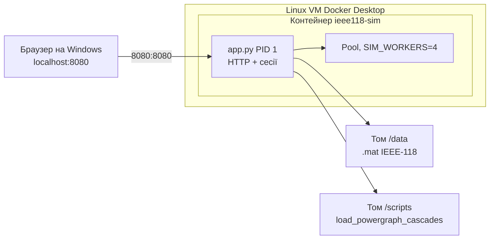

# PLAN3-DOCER — Етап 3: образ, Compose, квоти

Статус: **APPROVED**. Файли образу записані в `source/docker-web/`. `app.py`, `engine.py`, `loader.py` без змін.

Команди §7 виконує студент. Агент термінал, `docker`, `pip` і скріншоти не запускає.

Прийнято в рецензії: §1.2 (томи + `ENV` `/data` і `/scripts`). Бенчмарк §7.5 лишається як написаний, його замінять окремо. Жорсткі ліміти Compose зафіксовані: `8080:8080`, `cpus: "2.00"`, `memory: 512M`, мережа `bridge`. Вимоги зібрані з:

- `@cloud_grid/docs/p03_docker_web.md` — §4–§5 (зразок Dockerfile і Compose), §7 (кроки 1–4: health, `docker stats`, OOM 137, bare-metal проти контейнера), §8 (проєкт IEEE-118: `python:3.11-slim`, non-root, `cpus: "2"`, `memory: "1G"`, одна команда `docker compose up --build`), §9 (питання захисту);
- `@cloud_grid/docs/n01_power_grid_project.md` — §3 «Етап 3»;
- `@my-grid-lab/docs/work/PLAN3-WEB.md` — уже зібраний процес, HTTP і фізика; §7 цього плану якраз відкладав образ і cgroups сюди;
- `@cloud_grid/source/docker-web/Dockerfile`, `docker-compose.yml` — навчальний зразок реактора, один контейнер.

Веб і розрахунок уже є в `my-grid-lab/source/docker-web/`. Цей етап пакує той самий процес і вимірює ізоляцію. Фізику, ендпоінти і кольори графа не міняємо.

---

## 0. Що додається до локального веб-етапу

| | Зараз, `python app.py` | Цей етап |
| :--- | :--- | :--- |
| Де живе процес | venv на Windows | Той самий `app.py` як PID 1 у `python:3.11-slim` |
| Хто читає `.mat` | Батько, один раз | Батько, один раз. Файл приходить томом, не шаром образу |
| Скрипти курсу | `SCRIPT_DIR` за замовчуванням на диск лабораторії | Той самий каталог, змонтований у `/scripts` |
| Порт | `localhost:8080` на хості | `ports: "8080:8080"` у мережевий namespace контейнера |
| Стеля CPU / RAM | Немає | `cpus: "2.00"`, `memory: 512M` |
| Воркери веб-сесії | `cpu_count()` машини | `SIM_WORKERS=4` навмисно вище за квоту 2 CPU |
| Перевірка | curl і браузер | Те саме ззовні плюс `docker stats`, OOM і три прогони часу |

Еталон лічильників той самий, що в PLAN3-WEB §0: `s = 83810`, `seed = 42`, `N = 10 000`, `weighted`, `unrated_margin = 2.0`, `threshold = 0.05`. Для `k = 1`: `P(blackout) = 0`, `cascade_fraction = 0`, `mean_dns_proxy = 6.431682344513669e-05`. Образ, який дає інші лічильники, непридатний, навіть якщо сторінка відкривається.

---

## 1. Рішення

### 1.1. Скільки контейнерів

n01 у етапі 3 перелічує окремий worker, FastAPI і Redis. Практична робота, за якою захищається етап, збирає API, сесії і пул в **одному** контейнері `reactor-sim`. PLAN3-WEB уже зафіксував: у одному процесі чергу замінює `Pool.map`.

| Варіант | Плюс | Мінус |
| :--- | :--- | :--- |
| **A. Один сервіс `ieee118-sim`** | `docker compose up --build` піднімає дашборд, який уже написаний. Кроки §7 практичної роботи лягають на ті самі ендпоінти. cgroups обмежують саме той процес, який рахує | Рядок n01 про Redis лишається невідтвореним. Два браузери, як і зараз, ділять один пул |
| B. Web + Redis + окремий worker | Буквальний список n01 | Новий протокол черги, інший HTTP-каркас, інший життєвий цикл пулу. Зібраний `GridHandler` довелося б викинути. Практична робота такого запуску не показує |
| C. `docker compose up --scale` того самого образу | Кілька контейнерів без нового коду | Кожен тримає власний пул і власну копію сценарію. Один прогін Монте-Карло між ними не ділиться |

Беремо **A**. Воркер етапу — це `multiprocessing.Pool` усередині контейнера. Окремий брокер має сенс, коли рахунок і HTTP опиняться в різних процесах; зараз їх розділяє лише namespace контейнера від решти хоста.



Мережа `grid-net` (bridge) лишається, як у зразку, навіть з одним сервісом: на захисті є що показати в `docker network`. Сусіднього контейнера, який резолвиться через DNS цієї мережі, немає.

### 1.2. Звідки контейнер бере датасет і завантажувач

Всередині образу `Path(__file__).parents[1]` — це `/`, не `my-grid-lab`. Замовчування `DATA_DIR` / `SCRIPT_DIR` з локального запуску там порожні. Змінні вже вміє читати `loader.py`. Код шляхів не переписуємо.

Каталог на хості `my-grid-lab/dataset/dataset_cascades` містить вкладений `dataset_cascades/ieee118/ieee118/raw/`. Саме його чекає `find_cascades_raw`, якщо `DATA_DIR` вказує на зовнішній `dataset_cascades`.

| Варіант | Плюс | Мінус |
| :--- | :--- | :--- |
| **A. Два read-only томи, context збірки = `source/docker-web`** | У образ потрапляють три модулі і wheels. Важкі `.mat` не їдуть у daemon на кожен `build`. Скрипти курсу лишаються однією копією | Контейнер без цих двох mount не стартує: це очікувана помилка `FileNotFoundError`, код виходу 1, не 137 |
| B. Розширити context до `projects/` і `COPY` датасет у шар | Образ самодостатній | У context потрапляють `dataset_cascades.zip` і `raw.7z`. Збірка на Docker Desktop тягне сотні мегабайтів навіть з `.dockerignore`. Оновлення файлу даних інвалідує шар |
| C. Скопіювати `dataset_scripts` у `source/docker-web` і запекти в образ | Менше один том | Друга копія завантажувача курсу розходиться з `cloud_grid` |

Беремо **A**. Зафіксовано.

ENV сам по собі датасет не підключає. У контейнері немає диска `C:\`. `DATA_DIR=/data` і `SCRIPT_DIR=/scripts` лише називають каталоги всередині Linux. Файли туди кладе Compose: два томи лише для читання. `loader.py` ці змінні вже читає, код не змінюється.

```text
хост my-grid-lab/dataset/dataset_cascades  →  /data      DATA_DIR
хост cloud_grid/source/dataset_scripts     →  /scripts   SCRIPT_DIR
```

Відносні шляхи в Compose рахуються від `my-grid-lab/source/docker-web/docker-compose.yml`:

```text
../../dataset/dataset_cascades
../../../cloud_grid/source/dataset_scripts
```

`DATA_DIR=/data` і `SCRIPT_DIR=/scripts` записуються в `ENV` образу: це точки монтування, не шляхи Windows і не секрети. `docker inspect` їх покаже, і це нормально.

### 1.3. Квоти

Зафіксовано для `docker-compose.yml`:

- прокидання `8080:8080` з інтерфейсу хоста в `net` namespace контейнера;
- CPU `cpus: "2.00"` — 200 мс процесорного часу на кожні 100 мс інтервалу планувальника;
- пам’ять `memory: 512M`;
- мережа `grid-net` з `driver: bridge`.

§8 практичної для проєкту IEEE-118 пише `memory: "1G"`. У цій здачі стеля сервісу — `512M`, як у умовах маніфесту вище. Ліміт у файлі не піднімаємо. Якщо старт із scipy/h5py і чотирма воркерами впреться в цю стелю, `docker inspect` покаже код `137`, і це результат прогону, а не привід змінити маніфест.

Окремий пробний контейнер на 64 МБ лишається лише для кроку OOM (§7.4) і в Compose не записується. Процедуру бенчмарку з §7.5 не чіпаємо: її замінять пізніше. У командах цього кроку `--memory` стоїть `512m`, щоб разова прогонка мала ту саму стелю пам’яті, що й сервіс.

`SIM_WORKERS=4` при квоті 2 CPU дає видимий throttling: чотири процеси ділять два ядра, `docker stats` упирається в близько `200%`. Якби воркерів було рівно 2, стеля збіглася б із звичайним навантаженням і на скріншоті її не відрізнити.

`os.cpu_count()` у контейнері читає `/proc/cpuinfo` віртуальної машини Docker Desktop, не `cpu.max`. Це спостереження питання 3 з §9. Його треба записати з `/api/metrics` (`workers`) і з файлу cgroup, а не «виправляти» в коді.

Ключі лімітів у файлі Compose дублюються навмисно:

| Ключ | Хто його застосовує |
| :--- | :--- |
| `deploy.resources.limits` | Форма з практичної роботи. Swarm і актуальний Compose v2 |
| `cpus` і `mem_limit` на сервісі | Той самий ceiling для `docker compose up` там, де `deploy` поза Swarm ігнорується |

Числа однакові: `2.00` CPU і `512M`. Після старту це перевіряє `docker inspect` (§7.2). Очікування: `NanoCpus=2000000000`, `Memory=536870912`. Якщо там нулі, ліміт не приклався і крок із `docker stats` недійсний.

`reservations` (1 CPU, 256M) — м’який запит зі зразка. На скріншоті дивимось `limits`, не reservations.

`restart: unless-stopped` стоїть на основному сервісі. Пробник OOM його не використовує: інакше Compose підніме вбитий процес знову і код 137 розчиниться в перезапусках.

### 1.4. Базовий образ і залежності

`python:3.11-slim`, як §4 і §8 практичної роботи. Локальний venv у студента може бути іншим мінорним Python (поруч лежить кеш `cpython-314`). Образ усе одно 3.11: так збірка збігається з курсом, а wheels numpy/scipy стоять під glibc. Alpine не беремо: musl змушує збирати наукові пакети з сирців.

Список пакетів — наявний `requirements.txt`: `numpy`, `scipy`, `h5py`, `networkx`, `matplotlib`. У §8 названі лише перші три наукові пакети плюс networkx. `h5py` потрібен, бо `.mat` IEEE-118 — MATLAB v7.3. `matplotlib` потрібен гілці `--headless` (графік speedup, backend `Agg` уже вмикається в `app.py`). Окремий `requirements` для образу не заводимо.

Версії не піннемо, доки `pip install` у збірці проходить. Якщо індекс віддасть збірку, якій потрібен Python новіший за 3.11, тоді зафіксувати ті версії, які вже стоять у локальному venv, і перезібрати. До цього моменту піни в план не входять.

### 1.5. PID 1, користувач, шари

Обробник `SIGTERM` уже стоїть у `serve()` і закриває пул через `close` + `join`. Для цього форма `ENTRYPOINT` має бути exec, як у зразку: процес Python — PID 1, `docker stop` доставляє сигнал йому, а не оболонці `/bin/sh`.

Користувач `appuser` / `appgroup`, uid/gid `10001`, після `COPY`. Порт `EXPOSE 8080`. Healthcheck б’є в `http://localhost:8080/api/health` через `urllib`, бо в slim немає `curl`.

`start-period` ставимо **40 с**, не 5 с зі зразка реактора. До слухання порта батько читає зріз HDF5 і рахує Kamada–Kawai. Короткий період позначає живий старт як `unhealthy`.

Порядок шарів:

1. `FROM`, `ENV`, `WORKDIR`
2. `COPY requirements.txt` і `pip install`
3. користувач
4. `COPY` лише `app.py`, `engine.py`, `loader.py`
5. `USER`, `EXPOSE`, `HEALTHCHECK`, `ENTRYPOINT`

Права на запис бенчмарку: каталог `/out` створюється в образі й віддається `appuser`. Звіти headless пишуться туди. Windows bind-mount часто все одно приходить у контейнер як root. Якщо `appuser` отримає `PermissionError`, один прогін вимірювання перезапускається з `--user 0` (§7.5). На час хвилі це майже не впливає; у звіті цей прогін так і підписується. Код заради прав на томі не змінюємо.

`.dockerignore` відсікає `.venv`, `__pycache__`, `bench-out`, json і png бенчмарків. Віртуальне середовище Windows у контексті збірки ламає образ і роздуває передачу в daemon.

Змінні потоків BLAS у `ENV` образу: `OMP_NUM_THREADS`, `OPENBLAS_NUM_THREADS`, `MKL_NUM_THREADS`, `NUMEXPR_NUM_THREADS` дорівнюють `1`. Гарячий цикл `run_trial` їх не використовує, він на чистому Python. Змінні не дають бібліотеці під час `import numpy` підняти пул потоків на всі ядра VM перед `fork` пулу і не множать потоки понад квоту 2 CPU. Той самий набір студент виставляє в PowerShell перед bare-metal прогоном, щоб різниця часів була від контейнера і квоти.

Старт методу `Pool` у коді не чіпаємо. На Windows це `spawn`, у Linux 3.11 за замовчуванням `fork`. `initializer` + `initargs` розраховані на обидва. Якщо headless у контейнері зависне на першому `map` і процес не їсть CPU, це фіксується в звіті окремим рядком. Лікування тоді — окреме маленьке рішення (примусовий `spawn`), не частина цієї чернетки.

Секрети в `ENV` не кладемо. Класти нічого: паролів у сервісі немає. Питання 1 з §9 закривається цим фактом і тим, що датасет приїжджає томом під час запуску.

---

## 2. Файли після APPROVE PLAN

| Файл | Дія |
| :--- | :--- |
| `source/docker-web/Dockerfile` | Новий, текст §3 |
| `source/docker-web/docker-compose.yml` | Новий, текст §4 |
| `source/docker-web/.dockerignore` | Новий, текст §5 |
| `source/docker-web/README.md` | Додати розділ запуску через Compose: команда, томи, ліміти, `curl.exe`, зупинка. Абзац «Образ і Compose — наступний етап» замінити на посилання сюди |
| `source/docker-web/app.py`, `engine.py`, `loader.py`, `requirements.txt` | Без змін |
| `source/grid-mimd/`, `source/ray-grid/` | Без змін |

Каталог здачі лишається `source/docker-web`. §8 практичної роботи пише `source/grid-web/`; у PLAN3-WEB місцем здачі вже названо `docker-web`, і веб лежить там.

---

## 3. Dockerfile

```dockerfile
FROM python:3.11-slim

ENV PYTHONUNBUFFERED=1 \
    PYTHONDONTWRITEBYTECODE=1 \
    PORT=8080 \
    SIM_WORKERS=4 \
    SIM_K=2 \
    SIM_SCENARIO=83810 \
    SIM_SEED=42 \
    SIM_THRESHOLD=0.05 \
    SIM_TRIALS_PER_STEP=1000 \
    SIM_SHOCK=weighted \
    SIM_UNRATED_MARGIN=2.0 \
    DATA_DIR=/data \
    SCRIPT_DIR=/scripts \
    OMP_NUM_THREADS=1 \
    OPENBLAS_NUM_THREADS=1 \
    MKL_NUM_THREADS=1 \
    NUMEXPR_NUM_THREADS=1

WORKDIR /app

COPY requirements.txt .
RUN pip install --no-cache-dir -r requirements.txt

RUN groupadd -g 10001 appgroup && \
    useradd -u 10001 -g appgroup -s /bin/sh -m appuser && \
    mkdir -p /out && \
    chown appuser:appgroup /out

COPY --chown=appuser:appgroup app.py engine.py loader.py ./

USER appuser

EXPOSE 8080

HEALTHCHECK --interval=15s --timeout=3s --start-period=40s --retries=3 \
    CMD python -c "import urllib.request; urllib.request.urlopen('http://localhost:' + str(__import__('os').environ.get('PORT', 8080)) + '/api/health')" || exit 1

ENTRYPOINT ["python", "app.py"]
```

Аргументи після імені образу дописуються до `app.py`. Тому `docker run IMAGE --headless ...` лишається headless-прогоном, а `docker run IMAGE` без аргументів піднімає сервер.

---

## 4. docker-compose.yml

```yaml
version: "3.8"

services:
  ieee118-sim:
    build:
      context: .
      dockerfile: Dockerfile
    image: my-grid-lab/ieee118-sim:stage3
    container_name: ieee118-sim-service
    restart: unless-stopped
    ports:
      - "8080:8080"
    environment:
      PORT: "8080"
      SIM_WORKERS: "4"
      SIM_K: "2"
      SIM_SCENARIO: "83810"
      SIM_SEED: "42"
      DATA_DIR: /data
      SCRIPT_DIR: /scripts
    volumes:
      - ../../dataset/dataset_cascades:/data:ro
      - ../../../cloud_grid/source/dataset_scripts:/scripts:ro
    cpus: "2.00"
    mem_limit: 512m
    deploy:
      resources:
        limits:
          cpus: "2.00"
          memory: 512M
        reservations:
          cpus: "1.00"
          memory: 256M
    networks:
      - grid-net
    healthcheck:
      test: ["CMD", "python", "-c", "import urllib.request; urllib.request.urlopen('http://localhost:8080/api/health')"]
      interval: 15s
      timeout: 3s
      retries: 3
      start_period: 40s

networks:
  grid-net:
    driver: bridge
```

Перед `up` локальний `python app.py` на порту 8080 має бути зупинений. Інакше проброс порта не встає, і це помилка хоста, не образу.

---

## 5. .dockerignore

```text
.venv
__pycache__
*.pyc
bench-out
benchmark_results*.json
speedup*.png
```

---

## 6. Що показати на захисті цими кроками

| Питання §9 | Де це видно в роботі |
| :--- | :--- |
| 1. Чому секрет не кладуть в `ENV` | У шарі немає паролів. Датасет підключений томом на старті |
| 2. Порядок інструкцій і кеш | §7.6: правка коментаря в `app.py`, повторний `build`, шар `pip` лишається `CACHED` |
| 3. `cpu_count` проти квоти | §7.3: `workers` у metrics і файл `cpu.max` |
| 4. Throttling проти OOM | §7.3 (процес живий, час росте) і §7.4 (процес зникає, код 137) |

---

## 7. Сценарій студента

Робочий каталог далі:

```powershell
cd c:\Projects\GridSystems\projects\my-grid-lab\source\docker-web
```

У PowerShell `curl` — це інший командлет. HTTP-проби йдуть через `curl.exe`. Код виходу процесу — `$LASTEXITCODE`.

Перед bare-metal прогоном, в тому ж вікні:

```powershell
$env:OMP_NUM_THREADS = "1"
$env:OPENBLAS_NUM_THREADS = "1"
$env:MKL_NUM_THREADS = "1"
$env:NUMEXPR_NUM_THREADS = "1"
```

### 7.1. Збірка і health

```powershell
docker compose up --build -d
docker compose ps
docker compose logs ieee118-sim
```

У логах один рядок `loaded scenario s=83810 once`. Другого читання `.mat` на старті бути не повинно. `ps` протягом `start_period` може ще не писати `healthy`. Повторювати `ps`, доки стан не стане `Up (healthy)`, але не довше хвилини. Якщо контейнер у `Exit`, дивитися логи: `FileNotFoundError` означає том або `DATA_DIR`, не OOM.

```powershell
docker inspect ieee118-sim-service --format "Memory={{.HostConfig.Memory}} NanoCpus={{.HostConfig.NanoCpus}} User={{.Config.User}}"
curl.exe http://localhost:8080/api/health
curl.exe http://localhost:8080/api/metrics
```

Очікування inspect: пам’ять `536870912` (512 МіБ), `NanoCpus` `2000000000`, користувач `appuser`. Health: `status=healthy`, `dataset_loaded=true`, `workers=4`, `scenario=83810`. Metrics: 118 `nodes`, 186 `edges`.

Нуль у `Memory` або `NanoCpus` — квота не приклалась. Тоді подальші рядки `docker stats` у звіт не йдуть, доки ліміт не з’явиться в inspect.

Користувач усередині:

```powershell
docker exec ieee118-sim-service id
```

Очікування: `uid=10001(appuser)`.

Браузер: [http://localhost:8080](http://localhost:8080). До першого кроку граф уже намальований (ребра за завантаженням, вузли за `P_net`).

### 7.2. Скріншоти цього кроку

1. `docker compose ps` зі станом `healthy`.
2. Фрагмент логів з одним рядком завантаження сценарію `83810`.
3. Браузер, базовий граф, у кадрі видно адресу `localhost:8080`.

### 7.3. Throttling

Друге вікно термінала:

```powershell
docker stats ieee118-sim-service
```

У першому, після того як stats уже оновлюється. Хвиля за замовчуванням 1000 trials занадто коротка для інтервалу stats, тому сесія спочатку збільшує хвилю:

```powershell
curl.exe -X POST http://localhost:8080/api/reset -H "Content-Type: application/json" -H "X-Simulation-Session: bench" -d "{\"k\": 2, \"trials_per_step\": 10000}"
curl.exe -X POST http://localhost:8080/api/batch -H "Content-Type: application/json" -H "X-Simulation-Session: bench" -d "{\"steps\": 5}"
```

Поки batch не повернувся, у stats дивляться:

- `CPU %` тримається біля стелі `200%` і не розкривається на всі ядра VM;
- `MEM USAGE / LIMIT` показує стелю `512 MiB`. Якщо процес її перетинає, контейнер зникає з кодом `137` — це вже спостереження OOM на робочій квоті, його записують окремо від пробника на 64 МБ.

У відповіді batch записати `total_time_ms` і `avg_step_ms`.

Поруч, у третьому вікні, зняти те, що процес бачить сам:

```powershell
docker exec ieee118-sim-service python -c "import os; print('cpu_count', os.cpu_count())"
docker exec ieee118-sim-service sh -c "echo cpu.max; cat /sys/fs/cgroup/cpu.max; echo memory.max; cat /sys/fs/cgroup/memory.max"
```

`cpu.max` для двох ядер має вигляд квоти `200000` і періоду `100000` (мікросекунди): 200 мс на кожні 100 мс. `memory.max` — `536870912` байт. Якщо файлу cgroup v2 немає, у звіт іде пара з `docker inspect`, а відсутній шлях так і підписується.

Скріншот 4: `docker stats` під час batch, щоб у кадрі були і ім’я контейнера, і `CPU %`, і `MEM USAGE / LIMIT`.

Після кадру в браузері натиснути «1 крок» або дочекатися batch при `k = 2`. Ребра шоку бурштинові. Якщо в кадрі `cascade_trips = 0`, повторити batch, доки пігулка не стане `CASCADE` або `BLACKOUT`: тоді з’являються червоні ребра.

Скріншот 5: дашборд із цими кольорами, пігулкою статусу і бейджем workers.

### 7.4. OOM, код 137

Основний сервіс не чіпати. Окремий контейнер без `restart` і без публікації порта. Томи ті самі, інакше процес помре з кодом 1 на відсутньому файлі, і це не OOM.

```powershell
docker run --rm --memory=64m --name ieee118-oom -p 8081:8080 `
  -e DATA_DIR=/data -e SCRIPT_DIR=/scripts -e SIM_WORKERS=4 `
  -v "${PWD}\..\..\dataset\dataset_cascades:/data:ro" `
  -v "${PWD}\..\..\..\cloud_grid\source\dataset_scripts:/scripts:ro" `
  my-grid-lab/ieee118-sim:stage3
echo $LASTEXITCODE
```

64 МБ менші за імпорт numpy/scipy/h5py. Процес гине на старті, до першої хвилі Монте-Карло. Механізм ядра той самий, що й нестача пам’яті посеред batch: cgroup не віддає наступну сторінку, процес зникає. У логах шукати `Killed` або повідомлення memory cgroup. Очікуваний `$LASTEXITCODE` — `137` (`128 + 9`, `SIGKILL`).

Якщо замість цього Python встиг кинути `MemoryError` і код виходу `1`, у таблицю записати фактичний код і останній рядок лога. Стеля все одно спрацювала; відмінність лише в тому, хто помітив брак байтів першим — інтерпретатор чи OOM killer.

Скріншот 6: цей лог і рядок з кодом виходу.

Повернутись до живого сервісу: `curl.exe http://localhost:8080/api/health` досі `healthy`. Пробник його не чіпав.

### 7.5. Час: хост, контейнер без квоти CPU, контейнер із квотою 2

Процедуру нижче лишаємо. Оцінку студент може замінити пізніше; до того прогони і таблиця ті самі.

Три прогони, одні й ті самі аргументи розрахунку. Лічильники мають збігтися з таблицею §0 для `k = 1`. Час береться з рядка `workers=4` (поле `time_s` у JSON). Headless сам проходить 1, 2 і 4 воркери; у звіт кладемо весь масив `runs`, а порівняння стелі робимо по рядку `4`.

Каталог звітів:

```powershell
New-Item -ItemType Directory -Force -Path bench-out | Out-Null
```

Хост, з активованого venv, ті самі чотири змінні BLAS, що на початку §7:

```powershell
python app.py --headless --trials 10000 --k 1 --scenario 83810 --seed 42 --workers 4 --out bench-out\benchmark_results_host.json
```

Контейнер без стелі CPU, пам’ять як у сервісі (`512m`), щоб процес не ділив RAM із уже запущеним сервісом:

```powershell
docker run --rm --memory=512m --name ieee118-bench-free `
  -e DATA_DIR=/data -e SCRIPT_DIR=/scripts `
  -e OMP_NUM_THREADS=1 -e OPENBLAS_NUM_THREADS=1 -e MKL_NUM_THREADS=1 -e NUMEXPR_NUM_THREADS=1 `
  -v "${PWD}\..\..\dataset\dataset_cascades:/data:ro" `
  -v "${PWD}\..\..\..\cloud_grid\source\dataset_scripts:/scripts:ro" `
  -v "${PWD}\bench-out:/out" `
  my-grid-lab/ieee118-sim:stage3 `
  --headless --trials 10000 --k 1 --scenario 83810 --seed 42 --workers 4 --out /out/benchmark_results_docker_free.json
```

Той самий прогін зі стелею 2 CPU:

```powershell
docker run --rm --cpus=2.00 --memory=512m --name ieee118-bench-cap `
  -e DATA_DIR=/data -e SCRIPT_DIR=/scripts `
  -e OMP_NUM_THREADS=1 -e OPENBLAS_NUM_THREADS=1 -e MKL_NUM_THREADS=1 -e NUMEXPR_NUM_THREADS=1 `
  -v "${PWD}\..\..\dataset\dataset_cascades:/data:ro" `
  -v "${PWD}\..\..\..\cloud_grid\source\dataset_scripts:/scripts:ro" `
  -v "${PWD}\bench-out:/out" `
  my-grid-lab/ieee118-sim:stage3 `
  --headless --trials 10000 --k 1 --scenario 83810 --seed 42 --workers 4 --out /out/benchmark_results_docker_cap.json
```

Якщо запис у `/out` падає з `PermissionError`, дописати до **цього** `docker run` прапор `--user 0` і в таблиці позначити рядок «запис від root». Файл на хості має з’явитися в `bench-out\`. Існуючий `benchmark_results_docker_web.json` цими командами не перезаписується.

Заповнити:

| Прогін | CPU quota | `time_s` при 4 воркерах | trials/s | `cpu_count` у JSON | `P(blackout)` | `cascade_fraction` | `mean_dns_proxy` |
| :--- | :--- | :--- | :--- | :--- | :--- | :--- | :--- |
| Хост, `bench-out\benchmark_results_host.json` | немає | | | | | | |
| Контейнер, `benchmark_results_docker_free.json` | немає | | | | | | |
| Контейнер, `benchmark_results_docker_cap.json` | 2.00 | | | | | | |

Три колонки лічильників збігаються з §0 (`k = 1`). `deterministic_across_workers` у кожному файлі — `true`. `time_includes_pool_startup` — `false`.

Дві частки, у відсотках, від часів рядка `workers=4`:

- накладні витрати контейнера без квоти: `(t_free - t_host) / t_host`;
- ціна throttling: `(t_cap - t_free) / t_free`.

Перша — це ізоляція і том через файлову систему VM. Друга — стисливість CPU: процес дорахував і не втратив лічильники, лише виріс `time_s`. Поруч OOM із §7.4: пам’ять так не розтягується, стан прогону зникає.

`cpu_count` у JSON контейнера може бути більшим за 2. Це число VM, не квота. Колонка в таблиці якраз для цього.

Скріншот 7: три рядки `workers=4` з термінала або заповнена таблиця.

Крива `runs` (1 → 2 → 4) на хості і в прогоні `--cpus=2` йде в звіт як графік з `bench-out` (`speedup` поруч із кожним json). Під квотою 2 CPU приріст від 2 до 4 воркерів має сісти; на хості з більше ніж двома ядрами він ще помітний. Якщо хост сам двоядерний, обидві криві будуть близькі, і це теж результат: throttling ні на що додаткове не налазить.

### 7.6. Кеш шарів і зупинка

Додати один коментар у кінець `app.py` (порожній рядок з `#`), зберегти, зібрати ще раз:

```powershell
docker compose build
```

У лозі збірки крок `pip install` має бути `CACHED`. Крок `COPY` модулів — ні. Прибрати коментар після перевірки, щоб в дереві не лишався сміттєвий diff, і перезібрати ще раз перед здачею, якщо цей коментар не потрібен у коді.

Скріншот 8: фрагмент збірки, де видно `CACHED` на `pip` і новий шар коду.

Зупинка з доставкою `SIGTERM`:

```powershell
docker stop ieee118-sim-service
docker compose logs ieee118-sim --tail 20
docker inspect ieee118-sim-service --format "{{.State.ExitCode}}"
```

У логах рядок обробника про сигнал `15` (`SIGTERM`). Код виходу `0` означає, що обробник встиг завершити процес до примусового `SIGKILL` (його код був би `137`). Потім:

```powershell
docker compose down
```

Скріншот 9: лог `SIGTERM`.

---

## 8. Поза цією роботою

- Зміни формул каскаду, контракту HTTP і дашборда.
- FastAPI, Redis, другий контейнер воркера.
- Образ на базі Alpine, окремий фронтенд-контейнер, Kubernetes.
- Піни версій у `requirements.txt`, доки збірка 3.11 сама проходить.
- Перезапис `benchmark_results_docker_web.json` і прогонів етапу 1.
- Примусова зміна start method пулу, доки контейнерний headless сам не зависне.

---

## 9. Коли етап можна здавати

Файли §2 зібрані командою `docker compose up --build`. Сервіс стає `healthy`. Ззовні живі `/`, `/api/health`, `/api/metrics`, крок і batch. У stats під навантаженням CPU біля 200%, пам’ять у межах 512 МіБ. Окремий контейнер на 64 МБ закінчується аварійно, основний після цього живий. Три JSON §7.5 мають однакові лічильники `k = 1` і різні `time_s`, з яких рахуються дві частки. Дев’ять скріншотів §7 лежать у звіті поруч із таблицею.
