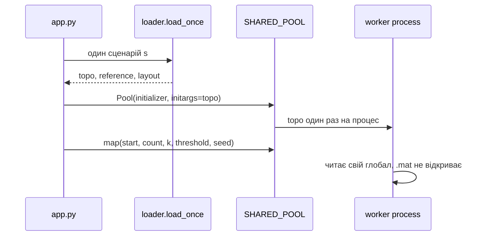

# PLAN3-WEB — Етап 3: IEEE-118 cascade Monte Carlo, Web UI

Статус: **v2 APPROVED**. Код у `my-grid-lab/source/docker-web/`. Термінал, `pip`, `git` — після **APPROVE CODE**.

v2: веб-сервер на локальній машині. Образ і Compose — наступний етап. Окремої черги між сервісами немає: батько і воркери живуть в одному процесі ОС.

Джерела:

- `@my-grid-lab/source/grid-mimd/app.py`, `engine.py`, `README.md` — ядро каскаду і CLI етапу 1;
- `@my-grid-lab/source/ray-grid/loader.py` — читання `.mat` один раз, поза модулем воркера;
- `@cloud_grid/source/docker-web/app.py` — веб-сервер, спільний `Pool`, дашборд, сигнали, сесії;
- `@cloud_grid/docs/n01_power_grid_project.md` — §1.5 і §2.5 (кольори графа), §3 «Етап 3»;
- `@my-grid-lab/docs/work/PLAN.md` — фізика, яку тут не змінюємо.

Здача цього етапу: аналог `grid-mimd/app.py` плюс UI за зразком `docker-web/app.py` і чотири ендпоінти `/api/health`, `/api/step`, `/api/batch`, `/api/metrics`. Процес один, пул усередині нього. n01 у тому самому етапі згадує FastAPI, Redis і окремий контейнер воркера — це розкладка на кілька сервісів. Її тут немає: черга потрібна, коли веб і розрахунок у різних процесах і мають передавати завдання одне одному. Зараз завдання передає `Pool.map`. Dockerfile і Compose теж відкладені (§7).

`source/grid-mimd/` і `source/ray-grid/` не змінюємо.

---

## 0. Що змінюється відносно етапу 1

| | Етап 1 `source/grid-mimd/` | Етап 3 `source/docker-web/` |
| :--- | :--- | :--- |
| Вхід | CLI `python app.py` | Той самий CLI і HTTP на `PORT` (default `8080`) |
| Хто читає `.mat` | Батько, один раз на процес | Батько, один раз на процес |
| Що імпортує воркер | `engine.py`, а той на імпорті тягне `load_powergraph_cascades` | Лише `engine.py`. Завантажувача в ньому немає |
| Як топологія потрапляє у воркер | Поле `topo` в **кожному** аргументі чанка; новий `Pool` на кожен `run()` | Один раз в `Pool(..., initializer=..., initargs=(topo,))`. Чанк без `topo` |
| Час у бенчмарку | Включає старт `Pool` (`time_includes_pool_startup: true`) | Пул уже стоїть, коли стартує таймер (`false`) |
| Картинка | PNG у `plots/` за `--viz` | Canvas у браузері: граф IEEE-118 |
| Обов’язкові HTTP | немає | `GET /api/health`, `GET /api/metrics`, `POST /api/step`, `POST /api/batch` |

Фізика та сама, що в PLAN.md §3–§7: `capacity` для `lr <= 0` дорівнює `m·|P_ij|` (`m = 2.0`); шок `weighted`; TRIP — одна найгірша лінія за крок; seed trial `i` = `base_seed * 1_000_003 + i`; `MAX_STEPS = 186`.

Еталон лічильників — уже зняті прогони етапу 1, сценарій `s = 83810`, `seed = 42`, `N = 10 000`, `--shock weighted`, `--unrated-margin 2.0`, `--threshold 0.05`:

| `k` | `P(blackout)` | `cascade_fraction` | `mean_dns_proxy` | Джерело |
| :--- | :--- | :--- | :--- | :--- |
| 1 | 0.0 | 0.0 | `6.431682344513669e-05` | `benchmark_results_mimd_grid.json` |
| 2 | 0.0002 (2 / 10 000) | 0.0018 (18 / 10 000) | `0.0001849173598996644` | `benchmark_results_mimd_grid_k2.json` |

Топ при `k = 2`: гілки 55 (34–37), 14 (9–10), 54 (34–36).

---

## 1. Рішення

Нижче зафіксовано варіант, з яким писати код після APPROVE PLAN.

### 1.1. Який HTTP

Один локальний процес: `http.server.HTTPServer` і спільний `multiprocessing.Pool`, як `@cloud_grid/source/docker-web/app.py`. Батько читає сценарій і роздає топологію воркерам пулу. Окремий брокер цю передачу дублював би.

Наслідки:

- обробник — `GridHandler` (у n01 так і названо аналог `ReactorHandler`);
- сторінка — рядок `HTML_PAGE` у `app.py`, мова інтерфейсу українська, та сама темна палітра, що в зразку;
- `GET /` і `GET /index.html` віддають дашборд. Цього шляху немає в списку обов’язкових, без нього UI немає;
- `POST /api/reset` теж є у зразку. Без нього повзунки `k` / порога / розміру кроку нікуди писати. Входить у роботу;
- `HTTPServer` обслуговує один запит за раз, як зразок. `pool.map` додатково під `threading.Lock`: крок, batch і перезавантаження топології не перетинаються;
- `SIGINT` (Ctrl+C) закриває пул і виходить. Обробник `SIGTERM` лишається поруч, як у зразку: він знадобиться наступному етапу, коли процес стане PID 1.

### 1.2. Де лежить код

| Варіант | Плюс | Мінус |
| :--- | :--- | :--- |
| **A. `engine.py` + `loader.py` + `app.py`** | Воркер імпортує лише `engine.py`. Той самий розріз, що в `source/ray-grid/` | Три файли замість одного, як у реакторному `app.py` |
| B. Усе в одному `app.py` | Близько до зразка `docker-web/app.py` | На Windows `spawn` воркер імпортує весь модуль. Разом із HTTP і завантажувачем він знову відкриє шлях до `.mat` — це саме те, що прибираємо |
| C. Імпорт `grid-mimd.engine` | Немає копії формул | Модуль етапу 1 на імпорті тягне `load_powergraph_cascades`. Воркер знову піднімає scipy / h5py |

Беремо **A**. Формули копіюємо з `grid-mimd/engine.py` (`prepare_topology`, `run_trial`, `simulate_trials_chunk`, `merge_stats`, `shock_share`). `GridSimulationEngine.run()` з етапу 1, який сам створює `Pool`, не копіюємо: життєвим циклом пулу керує `app.py`.

`engine.py` не імпортує numpy, scipy, h5py, networkx, matplotlib, `loader`. `check_loaded` живе в `loader.py`, як у ray-grid.

Розходження копії з етапом 1 ловить перевірка §8: ті самі `P(blackout)`, `cascade_fraction`, `mean_dns_proxy` і ті самі три гілки топу.

### 1.3. Завантаження один раз і роздача воркерам

Зараз `grid-mimd/engine.py` читає сценарій один раз у батька, але:

- імпорт модуля вже підтягує завантажувач, тож кожен spawn-воркер імпортує його знову;
- `Pool` створюється всередині кожного `run()`;
- кожен чанк несе повний `topo` (~9 КБ, `topology_pickle_bytes = 9021`).

На Windows (`spawn`, машина розробки) новий воркер не бачить глобал батька. Роздача має бути явною: `initializer` передає `topo` кожному процесу один раз. На `fork` той самий виклик теж спрацьовує, тож код один.

| Варіант | Плюс | Мінус |
| :--- | :--- | :--- |
| **A. `initializer` + `initargs=(topo,)` один раз на процес воркера** | Працює і зі `spawn`, і з `fork`. Чанк містить лише `(start, count, k, threshold, base_seed)`. Повторного читання `.mat` немає. Зміна сценарію = новий пул, знову один раз | Прихований глобал у воркері. Зміна `shock` / `scenario` / `unrated_margin` перезапускає пул |
| B. `topo` в кожному чанку, як етап 1 | Без глобала | Це поточна логіка. Запит якраз змінити роздачу. На кожен `map` ті самі 9 КБ їдуть знову |
| C. Лише успадкування пам’яті після `fork`, без `initargs` | На `fork` нуль pickle | На Windows воркер бачить порожній глобал. Локальний прогін ламається |

Беремо **A**.



Протокол:

1. `loader.load_once(data, scenario, unrated_margin, shock_mode)` викликає `load_powergraph_cascades` і `build_topology` **всередині функції**, після перевірки `SCRIPT_DIR`. Повертає `topo`, `reference`, `summary`, координати вузлів.
2. Координати рахує батько один раз: `networkx.kamada_kawai_layout`, `seed` розкладки фіксований алгоритмом networkx (детермінований для цього графа). У JSON координати нормалізовані на відрізок `[0, 1]`. Підпис у UI: розташування алгоритмічне, не географія — як заголовок `visualize_grid_graph.py`.
3. `engine.install_topo(topo)` — функція рівня модуля. Її передаємо як `initializer`. Вона кладе dict у глобал `_TOPO` цього процесу.
4. `simulate_trials_chunk` читає `_TOPO`. Якщо глобал порожній — `RuntimeError` (пул підняли раніше за роздачу).
5. `get_shared_pool(workers, topo)` створює пул, якщо його ще немає. `shutdown_shared_pool()` як у зразку: `close` + `join`, за сигналом без `terminate`, щоб дочекатись чанка.
6. Зміна `scenario`, `shock` або `unrated_margin`: `shutdown_shared_pool`, знову `load_once`, новий пул. `k`, `seed`, `threshold`, `trials_per_step` топологію не чіпають.
7. Повний масив 122 500 сценаріїв не читаємо. Зріз `slice(s, s + 1)`, як `load_scenario` етапу 1.

Шляхи. Розкладка та сама, що в `ray-grid/loader.py` (`source/docker-web` на тій самій глибині, що `source/ray-grid`):

```text
DATA_DIR   = my-grid-lab/dataset/dataset_cascades
SCRIPT_DIR = projects/cloud_grid/source/dataset_scripts
```

`DATA_DIR` і `SCRIPT_DIR` можна перевизначити змінними оточення. За замовчуванням сервер читає датасет з диска лабораторії.

### 1.4. Що саме робить `/api/step`

n01 ставить у відповідність `step()` ↔ `run_trial()` (одна траєкторія). У зразку HTTP `POST /api/step` зрушує **всю** модель на один кадр і віддає його на canvas. Один `run_trial` послідовний: пул на такому кроці стоїть.

| Варіант | Плюс | Мінус |
| :--- | :--- | :--- |
| A. HTTP-крок = один `run_trial` | Буквально рядок таблиці n01. На canvas рівно ця траєкторія | Паралельність лише в `/api/batch`. Кнопка «Запуск» крутить тисячі дрібних POST |
| **B. HTTP-крок = хвиля з `trials_per_step` траєкторій на спільному пулі. У відповіді зведена статистика сесії і один показний trial** | Кадр дашборда використовує воркери. Граф малює конкретний каскад, як просить §1.5 | Ім’я `step` означає хвилю, не одну траєкторію. Це треба одним реченням у README |
| C. HTTP-крок = один внутрішній TRIP всередині trial | Схоже на тік реактора | Ламає `run_trial` як атомарне випробування. Статистика MC по кроках каскаду не збігається з етапом 1 |

Беремо **B**.

Показний trial всередині чанка: серед траєкторій чанка береться та, де `cascade_trips` найбільший; нічия — менший індекс. Батько так само обирає між чанками. Якщо в усій хвилі каскадів немає, лишається trial з найменшим індексом: на графі видно хоча б N-k шок.

Поле `example` у відповіді чанка на лічильники `merge_stats` не впливає. Цілі `blackouts`, `cascade_trials`, `in_shock`, `in_shock_blackout`, `tripped` лишаються сумами по seeds `trial_seed(base_seed, i)`.

Індекси сесії монотонні: перший крок бере `0 … trials_per_step-1`, наступний продовжує. Тому одна хвиля з `trials_per_step = 10000` збігається з прогоном етапу 1 на тих самих `k`, `seed`, `s`.

Default хвилі — `1000`. На `k = 2` частка каскадів 0.0018, тобто в хвилі з 1000 trials очікується близько двох каскадів, і граф частіше має що показати другим кольором. Верхня межа тіла запиту — `100_000`.

`POST /api/batch` з тілом `{"steps": N}` виконує N хвиль підряд, `1 ≤ N ≤ 100` (стеля як у зразку). Відповідь — останній кадр плюс `steps`, `total_time_ms`, `avg_step_ms`.

Статус кадру (пігулка на дашборді) береться з показного trial:

| `status` | Умова |
| :--- | :--- |
| `STABLE` | `cascade_trips == 0` |
| `CASCADE` | `cascade_trips > 0` і `blackout` хибний |
| `BLACKOUT` | `dns_proxy > threshold` |

Накопичені `p_blackout`, `mean_dns_proxy`, `cascade_fraction` — окремі числа сесії, їх пігулка не замінює.

### 1.5. Сесії

Як у зразку: `SessionManager`, TTL 300 с, ключ із заголовка `X-Simulation-Session`, інакше cookie `sim_session`, інакше `default_session`. `GET /` ставить cookie, якщо ключа ще не було.

Спільне на процес: топологія, пул, координати, еталон `dns_MW` / `output_features`.

Своє в сесії: `k`, `seed`, `threshold`, `trials_per_step`, курсор індексу trial, накопичені лічильники, номер кадру `tick`.

`POST /api/reset` з полями сесії скидає лічильники і курсор **цієї** сесії. Якщо в тілі змінені `scenario`, `shock` або `unrated_margin`, батько перезавантажує топологію для всього процесу і чистить лічильники **усіх** сесій: індекси старого графа більше не дійсні.

Один сценарій на процес. Два браузери ділять граф і ділять чергу запитів (один потік HTTP).

### 1.6. Що малює дашборд

Орієнтир — підписи §2.5 і абзац §1.5, не файли PNG.

До першого кроку (дані з `GET /api/metrics`) кадр дорівнює операційному стану до аварії:

- ребро фарбується за завантаженням `flow / capacity` (у зразку курсу це шкала plasma: бліде ребро — слабкий перетік, яскраве — напружена лінія);
- вузол фарбується за `P_net`: додатне — генерація, від’ємне — споживач;
- лінії з вихідним `lr <= 0` лишаються в даних як `capacity = 2·|P_ij|`; на графі вони просто мають свій `util`. Окремої matplotlib-діаграми `branch_flow_vs_capacity` у браузері немає.

Після кроку показний trial перекриває колір ребра, як просить §1.5:

| Стан ребра | Колір | Зміст |
| :--- | :--- | :--- |
| активне | шкала завантаження, як до аварії | лінія досі в роботі |
| N-k шок (`initial`) | бурштиновий `#f59e0b` | первинне збурення |
| каскад (`tripped`) | червоний `#ef4444` | вторинне вимкнення захистом |

Вузол-споживач (`load < 0`), у якого не лишилось жодної активної інцидентної лінії, малюється кільцем `#64748b`. Це та сама умова, що втрата навантаження в `run_trial`. Список таких вузлів рахує батько і кладе в `display.dark_buses`.

Легенда на canvas: активне / N-k / каскад / знеструмлений споживач.

`k = 1` на `s = 83810` дає `cascade_fraction = 0` навіть на 10 000 trials (етап 1). Для перевірки UI default веб-сесії — `k = 2`: тоді каскадний колір реально з’являється. CLI `--headless` за замовчуванням лишає `k = 1`, щоб звітний рядок збігався з обов’язковим прогоном етапу 1.

### 1.7. CLI лишається

`app.py` без прапорців піднімає сервер. З `--headless` сервер не слухає порт: один прогін, як `grid-mimd/app.py`.

Пул на кожне значення `workers` створюється **до** таймера і закривається після нього. У JSON поле `time_includes_pool_startup: false`. Решта полів `params` і `result` — як у етапі 1, щоб diff двох JSON читався як порівняння накладних витрат, а не як інша схема.

Графік speedup пишеться поруч із `--out` за тим самим правилом імен, що в етапі 1 (`speedup.png` для файла за замовчуванням). `--viz` немає: його роль виконує canvas.

Default `--out`: `my-grid-lab/source/docker-web/benchmark_results_docker_web.json`.

---

## 2. Файли

| Файл | Роль |
| :--- | :--- |
| `source/docker-web/engine.py` | Топологія в пам’яті воркера, `run_trial`, чанк, `merge_stats`, `install_topo` |
| `source/docker-web/loader.py` | `load_once`, перевірка розмірів, розкладка вузлів. Імпортує скрипти курсу лише з функції |
| `source/docker-web/app.py` | Пул, CLI, `GridHandler`, `HTML_PAGE`, сесії, сигнали |
| `source/docker-web/requirements.txt` | `numpy`, `scipy`, `h5py`, `networkx`, `matplotlib` |
| `source/docker-web/README.md` | Локальний запуск, таблиця ендпоінтів, чому `.mat` читається один раз |

`matplotlib` потрібен лише гілці `--headless`. У запиті `/api/step` його немає.

---

## 3. Контракт воркера

Глобал воркера: `_TOPO: dict | None`.

Чанк:

```text
simulate_trials_chunk((start, count, k, threshold, base_seed)) -> {
    trials, blackouts, dns_sum, cascade_trials,
    in_shock, in_shock_blackout, tripped,
    example: { index, cascade_trips, dns_proxy, blackout, initial, tripped }
}
```

Нарізка хвилі: `n_chunks = min(trials_per_step, workers * 4)` (`CHUNKS_PER_WORKER = 4`, як етап 1). `workers == 1` викликає функцію в батьківському процесі, без `map`, але після `install_topo` у цьому ж процесі — інакше глобал порожній.

`workers < 1` відхиляється на старті.

---

## 4. HTTP

Усі відповіді — `application/json; charset=utf-8`, крім `GET /`. Невідомий шлях — `404`. Зламаний JSON тіла — порожній об’єкт `{}`, як у зразку. Помилка валідації — `400` і `{"error": "..."}`.

### `GET /api/health`

Процес слухає порт лише після успішного `load_once` і створення пулу. Тому відповідь `200` вже означає, що дані прочитані.

```json
{
  "status": "healthy",
  "service": "ieee118-cascade",
  "stage": "03_web",
  "workers": 2,
  "scenario": 83810,
  "dataset_loaded": true,
  "pool": true,
  "timestamp": 0.0
}
```

### `GET /api/metrics`

Статичний знімок процесу плюс граф для першого кадру. Координати тут, а не в кожному кроці.

```json
{
  "service": "ieee118-cascade",
  "active_sessions": 1,
  "workers": 2,
  "pid": 1,
  "scenario": 83810,
  "shock_mode": "weighted",
  "unrated_margin": 2.0,
  "reference": {"dns_MW": 0.0, "output_features": 0.0},
  "layout": "kamada_kawai",
  "nodes": [{"id": 1, "x": 0.0, "y": 0.0, "load": 0.0}],
  "edges": [{"id": 0, "from": 1, "to": 2, "flow": 0.0, "capacity": 0.0}]
}
```

`nodes` — 118 записів, `edges` — 186. `id` вузла — шинний номер `1…118`.

### `POST /api/step`

Тіло необов’язкове. Хвиля йде з параметрів сесії. Відповідь:

```json
{
  "session_id": "sess_…",
  "tick": 1,
  "trials_this_step": 1000,
  "trials_total": 1000,
  "calc_time_ms": 0.0,
  "p_blackout": 0.0,
  "mean_dns_proxy": 0.0,
  "cascade_fraction": 0.0,
  "status": "STABLE",
  "k": 2,
  "threshold": 0.05,
  "display": {
    "trial_index": 0,
    "cascade_trips": 0,
    "dns_proxy": 0.0,
    "blackout": false,
    "shock": [0],
    "tripped": [],
    "dark_buses": []
  },
  "top_lines": []
}
```

`top_lines` — до 10 рядків у формі етапу 1 (`branch`, `from_bus`, `to_bus`, `in_shock`, `p_blackout_given_shock`, `cascade_trips`). Рядок без `in_shock > 0` не входить. `calc_time_ms` мірить лише хвилю (`map` або прямий виклик), без очікування сокета.

### `POST /api/batch`

Тіло: `{"steps": 10}`. Відсутнє `steps` — `10`. Поза `1…100` — `400`.

До полів кроку додаються `steps`, `total_time_ms`, `avg_step_ms`.

### `POST /api/reset`

```json
{
  "k": 2,
  "seed": 42,
  "threshold": 0.05,
  "trials_per_step": 1000,
  "scenario": 83810,
  "shock": "weighted",
  "unrated_margin": 2.0
}
```

Усі поля необов’язкові. Межі: `k` у `1…5`, `threshold` у `(0, 1]`, `trials_per_step` у `1…100000`, `shock` з `weighted|trunk|uniform`, `unrated_margin` дорівнює `0` або `≥ 1`, `scenario` — цілий індекс, який `load_once` здатний прочитати.

Відповідь: `{"status": "ok", "session_id": "…", "reloaded": false}`. `reloaded: true`, якщо пул зібрано заново.

---

## 5. Дашборд

Макет як у зразку: шапка, ліва колонка керування, праворуч canvas. Вузьке вікно (< 900px) складає колонки в один стовпчик.

Керування:

| Елемент | Дія |
| :--- | :--- |
| `k` (1…5) | у reset |
| trials на крок | у reset |
| поріг `dns_proxy` | у reset |
| сценарій `s` | у reset, перезавантажує граф |
| шок `weighted` / `trunk` / `uniform` | у reset, перезавантажує граф |
| Запуск / Пауза | цикл `POST /api/step`, поки попередній запит не повернувся |
| 1 крок | один `POST /api/step` |
| Batch | `POST /api/batch` з `steps: 10`, потім оновити кадр з відповіді |
| Скинути | `POST /api/reset`, потім знову намалювати базовий стан з `/api/metrics` |

Телеметрія: `P(blackout)`, середній `dns_proxy`, частка каскадів, пігулка `status`, trials за сесію, час хвилі, номер кадру, індекс показного trial, `cascade_trips` цього trial.

Canvas: 118 кругів і 186 відрізків. Клік по лінії не потрібен. Підписи номерів вузлів вимкнені (на 118 вузлах вони зливаються); номер є в `title` під курсором (`from–to`, стан ребра).

Перший виклик сторінки: `GET /api/metrics`, намалювати базовий стан, показати еталон `dns_MW` і `output_features` дрібним рядком. Це контроль, що відкрито саме `s`, а не інший режим.

Лог доступу: рядки `/api/step` не пишуться, як у зразку.

---

## 6. Локальний запуск

Каталог `source/docker-web` — ім’я місця в здачі. Цей етап образ не збирає.

Змінні оточення (усі необов’язкові; CLI їх перекриває):

| Змінна | За замовчуванням |
| :--- | :--- |
| `PORT` | `8080` |
| `SIM_WORKERS` | `cpu_count()` |
| `SIM_K` | `2` (веб-сесія; у `--headless` default `k = 1`) |
| `SIM_SCENARIO` | `83810` |
| `SIM_SEED` | `42` |
| `SIM_THRESHOLD` | `0.05` |
| `SIM_TRIALS_PER_STEP` | `1000` |
| `SIM_SHOCK` | `weighted` |
| `SIM_UNRATED_MARGIN` | `2.0` |
| `DATA_DIR` | `my-grid-lab/dataset/dataset_cascades` |
| `SCRIPT_DIR` | `projects/cloud_grid/source/dataset_scripts` |

```powershell
cd my-grid-lab\source\docker-web
python -m venv .venv
.\.venv\Scripts\Activate.ps1
pip install -r requirements.txt
python app.py
```

Сервер: `http://localhost:8080`. Зупинка — Ctrl+C. `--workers` задає розмір пулу, якщо `SIM_WORKERS` не стоїть.

---

## 7. Поза цією роботою

- Зміни `source/grid-mimd/` і `source/ray-grid/`.
- `Dockerfile`, `docker-compose.yml`, cgroup-ліміти, публікація порту з образу. Наступний етап, коли веб уже працює локально.
- Окрема черга і другий процес розрахунку. З’являться разом із кількома сервісами; у одному процесі їхню роботу робить `Pool`.
- Повторний розрахунок ємності `lr <= 0`. Лишається `--unrated-margin 2.0`.
- PNG `plots/` і гістограма `dns_MW` по всіх 122 500 сценаріях.
- Окремий ендпоінт `/api/run`. Запуск кадрів — це `/api/step` і `/api/batch`.

---

## 8. Перевірка після APPROVE CODE

Команди текстом, їх виконувати лише після APPROVE CODE.

1. Імпорт воркера. У `engine.py` немає `load_powergraph_cascades`, `scipy`, `h5py`. `loader.py` імпортує їх усередині `load_once`.
2. Локальний збіг з етапом 1:

```powershell
python app.py --headless --trials 10000 --k 1 --scenario 83810 --seed 42 --workers 1
python app.py --headless --trials 10000 --k 2 --scenario 83810 --seed 42 --workers 1 --out benchmark_results_docker_web_k2.json
```

Порівняти `result.p_blackout`, `result.cascade_fraction`, `result.mean_dns_proxy` і перші три `top_lines[].branch` з таблицею §0. `params.time_includes_pool_startup` дорівнює `false`.

3. Той самий `--headless --k 1` при `--workers 4`: цілі лічильники result збігаються з прогоном на 1 воркері (`deterministic_across_workers: true`).
4. HTTP, сервер уже слухає:

```powershell
curl http://localhost:8080/api/health
curl http://localhost:8080/api/metrics
curl -X POST http://localhost:8080/api/step -H "Content-Type: application/json" -H "X-Simulation-Session: bench" -d "{}"
curl -X POST http://localhost:8080/api/batch -H "Content-Type: application/json" -H "X-Simulation-Session: bench" -d "{\"steps\": 2}"
```

`health.status` = `healthy`, `dataset_loaded` = `true`. У `metrics` 118 `nodes` і 186 `edges`. Крок повертає `display.shock` довжини `k`.

5. Браузер: відкрити `http://localhost:8080/`, дочекатись базового графа (ребра за завантаженням, вузли за `P_net`). Натиснути «1 крок» при `k = 2`. Ребра зі `display.shock` бурштинові, ребра зі `display.tripped` червоні. Якщо `cascade_trips = 0`, натиснути Batch, доки в кадрі не з’явиться `CASCADE` або `BLACKOUT`. Вузол із `dark_buses` має сіре кільце. Пауза зупиняє цикл запитів. Скидання з іншим `s` оновлює граф і обнуляє лічильники. У логах процесу один рядок про завантаження сценарію `83810` і немає повторного читання `.mat` на кожен крок.

Крок 5 — основна перевірка UI. Скріншот сторінки без кліку по «1 крок» її не замінює.
