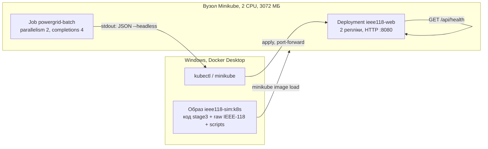

# PLAN4 — Етап 4: Minikube, Deployment, Job, порівняння

Статус: **APPROVED**. Файли записані в `source/k8s/`: `Dockerfile`, `deployment.yaml`, `service.yaml`, `job-batch.yaml`. `README.md` і `benchmark_k8s.json` з’являються після прогону §6. Термінал, `docker`, `minikube`, `kubectl` не запускались.

Команди §6 виконує студент. Агент їх не виконує.

Вимоги зібрані з:

- `@my-grid-lab/docs/work/TASK04.txt` — три маніфести, `benchmark_k8s.json`, таблиця, каталог `k8s/`;
- [Практична робота 4](https://vplanto.github.io/cloud_grid/p04_k8s_orchestration.html) — Minikube `--cpus=2 --memory=3072`, probes, Job, питання захисту. Зразок у тексті практики — реактор (`reactor-web`, `ReactorSimulationEngine`). Його скрипт `python -c` у наш образ не переноситься;
- `@cloud_grid/docs/07_k8s_orchestration_resources.md` — §4–§5 (requests, limits, QoS), §7 (веб як Deployment, пакет N-k як Job, для обчислювального пода `requests == limits`);
- `@cloud_grid/docs/n01_power_grid_project.md` — §3 «Етап 4». KEDA / HPA і прогін `10^6…10^7` у цю здачу не входять: їх немає в TASK04, а вузол на 2 CPU їх не витягне;
- `@my-grid-lab/source/docker-web/` — образ `my-grid-lab/ieee118-sim:stage3`, `ENTRYPOINT ["python", "app.py"]`, `/api/health`, каталог `/out` власника `appuser`;
- звіти етапів 1–3: `@my-grid-lab/source/grid-mimd/README.md`, `@my-grid-lab/source/ray-grid/REPORT.md`, `@my-grid-lab/source/docker-web/REPORT.md`.

`app.py`, `engine.py`, `loader.py` і `source/docker-web/Dockerfile` не змінюються.

---

## 0. Що вже виміряно і що додає цей етап

Спільні параметри всіх трьох звітів: `s = 83810`, `seed = 42`, `shock = weighted`, `unrated_margin = 2.0`, `threshold = 0.05`.

| Прогін | `N` | `k` | Де рахувалось | Час рахунку | Trials/s |
| :--- | ---: | ---: | :--- | ---: | ---: |
| Bare-metal, 1 процес | 10 000 | 1 | Windows, `cpu_count = 20` | 0.451 с | 22 149 |
| Docker, 1 процес | 10 000 | 1 | `python:3.11-slim`, ті самі 20 ядер, без стелі `cpus` | 0.402 с | 24 850 |
| Ray, head + worker | 600 000 | 2 | 2 вузли, 24 CPU, без Docker | 5.179 с | 115 846 |

Час bare-metal і Docker для одного процесу зіставний: пул не створюється, `P(blackout) = 0`. Ray — інший `N` і інший `k`. У таблицю він входить окремим рядком throughput, а не як «5 с проти 0.4 с».

Образ етапу 3 датасету не містить. Compose віддає його томами `DATA_DIR=/data` і `SCRIPT_DIR=/scripts`. У Minikube з `--driver=docker` шлях `C:\...` у `hostPath` — це шлях всередині вузла, не диск Windows. Тому дані їдуть окремим тегом образу (§1.2).

`python app.py` без аргументів не завершується: це HTTP-сервер. Job, який лишить `ENTRYPOINT` як є, ніколи не стане `Completed`. Команда пода має викликати `--headless` і вийти з кодом 0.

---

## 1. Рішення

### 1.1. Куди лягають файли

| Варіант | Плюс | Мінус |
| :--- | :--- | :--- |
| **A. `my-grid-lab/source/k8s/`** | Збігається з каталогом `k8s/` з TASK04 і з `source/k8s/` з практики. Поруч лежать `grid-mimd`, `ray-grid`, `docker-web` | Практичний §7 для курсового проєкту пише `source/grid-k8s/` |
| B. `source/grid-k8s/` | Буквальний шлях §7 | Друга назва каталогу при тому самому вмісті. Команда здачі з TASK04 шукає `k8s/` |
| C. Маніфести всередині `source/docker-web/` | Менше каталогів | Змішує здачу етапу 3 і етапу 4 |

Беремо **A**. Імена файлів з TASK04: `deployment.yaml`, `service.yaml`, `job-batch.yaml`, `benchmark_k8s.json`, `README.md`.

### 1.2. Звідки под бере `.mat` і завантажувач

На етапі 3 працюють дві різні речі, і в Compose вони стоять поруч:

| | Що це | Де на етапі 3 |
| :--- | :--- | :--- |
| Посилання | Рядки `DATA_DIR=/data` і `SCRIPT_DIR=/scripts`. `loader.py` відкриває ці каталоги | `ENV` образу і блок `environment` |
| Файли | Хтось кладе `.mat` і `dataset_scripts` у ці каталоги | Блок `volumes`: диски Windows змонтовані в `/data` і `/scripts` |

Сама змінна файлів не містить. Контейнер без томів теж має `DATA_DIR=/data` і падає на `FileNotFoundError`.

У подах лишаються ті самі рядки. Їх повторюють `env` у Deployment і в Job, як `environment` у Compose. Образ `stage3` їх уже несе, повтор у маніфесті потрібен, щоб посилання було видно поруч із подом.

Міняється лише другий рядок таблиці: хто кладе файли в `/data` і `/scripts`. Вузол Minikube — це контейнер. `hostPath: C:\Projects\...` шукає такий шлях усередині вузла, а не на диску Windows, тож том Compose туди не переноситься буквально.

`find_cascades_raw` приймає каталог, де лежить `blist.mat`, або батька з вкладеним `dataset_cascades/ieee118/...`. Скрипт `load_powergraph_cascades.py` імпортує `powergraph_mat.py` з тієї самої теки.

| Варіант | Плюс | Мінус |
| :--- | :--- | :--- |
| **A. Тег `my-grid-lab/ieee118-sim:k8s` поверх `stage3`** | `FROM` уже зібраного образу, шар `pip` не збирається знову. У вузол потрапляють лише 8 файлів `ieee118/raw` і `dataset_scripts`. Після `minikube image load` под не залежить від другого термінала. Читання йде з локального шару, тож холодний старт — це планувальник і старт процесу | Перший `docker build` і `image load` копіюють `.mat` двічі. Тег лишається локальним, у git його немає |
| B. `minikube mount` + `hostPath` і образ `stage3` як є | Збірка не чіпає датасет | Mount — окремий процес на передньому плані. Закритий термінал ронить поди. На docker-driver шлях Windows у `hostPath` сам по собі порожній. Читання через mount потрапляє в холодний старт і псує цей рядок таблиці |
| C. Запекти датасет у `source/docker-web/Dockerfile` | Один тег на етапи 3 і 4 | Переписує вже зданий образ і тягне `.mat` у кожен `compose build` |

Беремо **A**. `stage3` лишається образом етапу 3.



### 1.3. Скільки CPU просити на вузлі з двома ядрами

Кластер фіксований завданням: `minikube start --driver=docker --cpus=2 --memory=3072`. Планувальник дивиться на **requests**. **Limits** у вмістимість вузла не складаються, але пишуться в cgroup.

Лекція 7 для обчислювального пода вимагає Guaranteed (`requests == limits` і по CPU, і по RAM). Практичний §7 пише `limits.cpu: "2"` і `parallelism: 4`. Два такі поди на цей вузол не сідають: один запит на 2 CPU вже забирає весь вузол, системним подам місця немає.

| Варіант | Плюс | Мінус |
| :--- | :--- | :--- |
| **A. Job Guaranteed 250m / 512Mi, Deployment Burstable** | `requests == limits` у Job, клас QoS видно в `status.qosClass`. Сума requests: веб `2×100m` + Job `2×250m` = 700m і близько 1.3 ГіБ. Поруч лишається місце для `kube-system` і metrics-server. Один процес Python під стелею 250m дає стабільний час | Рахунок довший за Docker-прогін без стелі. Для CPU-bound циклу порядок — близько `0.402 × (1000/250)` с. Це наслідок квоти CFS, його так і записуємо |
| B. Числа зі зразка практики: веб 250m/1000m, Job 500m/1500m, Burstable | Збігається з YAML реактора в тексті практики | Job не Guaranteed. Два поди Job просять 1000m, разом із вебом і системними подами легко лишаються `Pending` |
| C. §7 буквально: ліміт 2 CPU, пам’ять 1 ГіБ, `parallelism: 4` | Той рядок методички | На виданому Minikube поди не проходять фільтр планувальника |

Беремо **A**.

Числа, які підуть у маніфести:

| Под | Репліки одночасно | requests | limits | QoS | Процеси всередині |
| :--- | ---: | :--- | :--- | :--- | :--- |
| `ieee118-web` | 2 | `100m`, `128Mi` | `500m`, `512Mi` | Burstable | `SIM_WORKERS=1` |
| `powergrid-batch` | 2 з 4 | `250m`, `512Mi` | `250m`, `512Mi` | Guaranteed | `--workers 1` |

Це два різні лічильники. Однакове число `1` тут збіг, не одне правило.

`ieee118-web` — дашборд, у таблицю часу він не входить. В образі стоїть `SIM_WORKERS=4`, у Compose теж 4, але там стеля сервісу `2.00` CPU на один контейнер. Тут реплік дві, і стеля одного пода `500m`. Чотири процеси в цій стелі ділять пів ядра, а сервер один: поки йде `/api/step`, `/api/health` відповіді не отримує. Тому в маніфесті вебу `SIM_WORKERS=1`, крок лишається 1000 випробувань. Паралельність вебу — це `replicas: 2`.

`powergrid-batch` — рядок бенчмарку. `--workers 1` тримає той самий дослід, що 0.451 с і 0.402 с: один процес, `N = 10 000`, `k = 1`. Прапорець CLI перекриває `SIM_WORKERS=4` з образу. Якби його не було, headless узяв би 4 процеси з `ENV` і `time_s` перестав би бути тим рядком. Паралельність Job — це `parallelism: 2` (два такі поди одразу). Другий поверх пулу всередині cgroup на `250m` додав би ще один спосіб ділити чверть ядра, і відношення до 0.402 с уже не читалось би як квота одного процесу.

CPU Manager `static` і `cpuCFSQuota: false` не вмикаємо. Pinning однаково вимагає цілого ядра в requests. На цьому вузлі цілого ядра на под немає.

Пам’ять 512 МіБ для Job — та сама стеля, що в Compose. Живий процес етапу 3 тримався біля 90 МіБ. Окремий OOM на 44 МіБ уже знятий (`exit 137`) і в ці маніфести не переноситься.

### 1.4. Що саме рахує Job

Чотири completions з одним seed — чотири однакові прогони. Індекс пода `app.py` не читає, діапазон випробувань не ріжеться. Паралелізм тут показує контролер Job, а не прискорення однієї суми.

| Варіант | Плюс | Мінус |
| :--- | :--- | :--- |
| **A. Кожен под рахує ті самі 10 000 випробувань, `k = 1`, `--workers 1`** | Той самий рядок, що bare-metal і Docker. Чотири JSON мають зійтись за `blackouts` і `cascade_trials`. Код рушія не змінюється | Стіна годинника Job — це дві хвилі по два поди, а не час одного рахунку. У таблицю йде `runs[0].time_s`, не колонка `DURATION` |
| B. `completionMode: Indexed` і шард на под | Чотири поди ділять `N` | В `app.py` немає зсуву діапазону. Це вже зміна рушія |
| C. `N = 600 000`, `k = 2`, як у Ray | Той самий розмір, що етап 2 | Інший за `N` від етапів 1 і 3. На 250m це вже хвилини на под, і топ ліній Ray не замінює |

Беремо **A**. Топ ліній лишається результатом Ray при `k = 2` і `N = 600 000` (гілки 55, 14, 22). При `k = 1` блекаутів 0, рейтингу немає. Це вже записано в етапі 1.

### 1.5. Як JSON опиняється в `kubectl logs`

`--headless` пише файл і друкує текст. У `kubectl logs` потрапляють stdout і stderr разом. Файл у контейнері після `Completed` з вузла командою здачі не забирається: TASK04 просить логи, без PersistentVolume.

| Варіант | Плюс | Мінус |
| :--- | :--- | :--- |
| **A. `sh -c`: людський вивід у `/out/run.log`, у stdout лише `cat` JSON** | `app.py` без змін. `/out` вже відданий `appuser`. Команда здачі збігається з TASK04 | Чотири поди дають чотири JSON-документи підряд. Файл — не один JSON-масив. У README так і написано |
| B. Змінна в `app.py`, один рядок JSON і жодних інших друків | Лог чистіший | Зміна програми заради формату лога. stderr усе одно змішується в `kubectl logs` |
| C. Лишити друк `--headless` як є | Нуль рядків у маніфесті команди | `benchmark_k8s.json` — це текст прогону, поля `time_s` в ньому треба вичитувати очима |

Беремо **A**. `set -eu`: якщо `python` завершився з ненульовим кодом, `cat` не виконується і под лишається невдалим.

Ім’я Job — `powergrid-batch`. Мітку `job-name=powergrid-batch` ставить сам контролер. Саме її використовує команда з TASK04.

---

## 2. Файли після APPROVE PLAN

| Файл | Дія |
| :--- | :--- |
| `source/k8s/Dockerfile` | Новий. Текст §3 |
| `source/k8s/deployment.yaml` | Новий. Текст §4 |
| `source/k8s/service.yaml` | Новий. Текст §4 |
| `source/k8s/job-batch.yaml` | Новий. Текст §4 |
| `source/k8s/README.md` | Новий після прогону студента: команди, таблиця §5 із заповненою колонкою Kubernetes, витяг одного `time_s` |
| `source/k8s/benchmark_k8s.json` | Створює студент командою §6.6 |
| `source/docker-web/app.py`, `engine.py`, `loader.py`, `Dockerfile` | Без змін |
| `source/grid-mimd/`, `source/ray-grid/` | Без змін |

---

## 3. Dockerfile

Контекст збірки — каталог `source/k8s` (у ньому лише цей файл). Дані приходять іменованими контекстами, не через батьківський каталог `projects/`.

```dockerfile
# syntax=docker/dockerfile:1
FROM my-grid-lab/ieee118-sim:stage3

USER root
COPY --from=data . /data
COPY --from=scripts . /scripts
RUN chown -R appuser:appgroup /data /scripts
USER appuser

ENV DATA_DIR=/data \
    SCRIPT_DIR=/scripts
```

`/data/blist.mat` задовольняє гілку `load_powergraph_cascades`, яка перевіряє `blist.mat` у корені `DATA_DIR`. Скрипти курсу лежать у `/scripts` разом із `powergraph_mat.py`.

---

## 4. Маніфести

### 4.1. `deployment.yaml`

Веб лишається довгим процесом. `k = 2` і сценарій `83810` вже стоять в `ENV` образу: на графі є каскад, як у етапі 3. Startup-проба тримає liveness, поки батько читає `.mat` і рахує Kamada–Kawai. Бюджет старту: `12 × 5 с = 60 с`. У Compose на це було `start_period: 40s`.

Обидві робочі проби б’ють у локальний `/api/health`. Зовнішньої бази немає.

```yaml
apiVersion: apps/v1
kind: Deployment
metadata:
  name: ieee118-web
  labels:
    app: ieee118-web
spec:
  replicas: 2
  strategy:
    type: RollingUpdate
    rollingUpdate:
      maxSurge: 1
      maxUnavailable: 0
  selector:
    matchLabels:
      app: ieee118-web
  template:
    metadata:
      labels:
        app: ieee118-web
    spec:
      containers:
        - name: ieee118-sim
          image: my-grid-lab/ieee118-sim:k8s
          imagePullPolicy: IfNotPresent
          ports:
            - name: http
              containerPort: 8080
          env:
            - name: PORT
              value: "8080"
            - name: DATA_DIR
              value: /data
            - name: SCRIPT_DIR
              value: /scripts
            - name: SIM_WORKERS
              value: "1"
            - name: SIM_K
              value: "2"
            - name: SIM_SCENARIO
              value: "83810"
            - name: SIM_SEED
              value: "42"
            - name: SIM_TRIALS_PER_STEP
              value: "1000"
            - name: PYTHONUNBUFFERED
              value: "1"
          resources:
            requests:
              cpu: "100m"
              memory: "128Mi"
            limits:
              cpu: "500m"
              memory: "512Mi"
          startupProbe:
            httpGet:
              path: /api/health
              port: http
            periodSeconds: 5
            timeoutSeconds: 3
            failureThreshold: 12
          livenessProbe:
            httpGet:
              path: /api/health
              port: http
            periodSeconds: 10
            timeoutSeconds: 2
            failureThreshold: 3
          readinessProbe:
            httpGet:
              path: /api/health
              port: http
            periodSeconds: 5
            timeoutSeconds: 2
            failureThreshold: 2
          securityContext:
            runAsNonRoot: true
            runAsUser: 10001
            runAsGroup: 10001
            allowPrivilegeEscalation: false
```

Дві репліки не ділять сесію. `port-forward` на Service розкладає запити між подами, лічильники дашборда в кожного свої. Для перевірки health це байдуже.

`maxSurge: 1` на час викочування піднімає третій под із request `100m`. У сумі з двома старими це 300m, не два ядра.

### 4.2. `service.yaml`

`NodePort` 30080 — як у практиці. З браузера Windows відкриваємо тунель: адреса `minikube ip` з хоста часто не маршрутизується.

```yaml
apiVersion: v1
kind: Service
metadata:
  name: ieee118-web
  labels:
    app: ieee118-web
spec:
  type: NodePort
  selector:
    app: ieee118-web
  ports:
    - name: http
      port: 8080
      targetPort: http
      nodePort: 30080
```

### 4.3. `job-batch.yaml`

Проби на Job не ставимо. Liveness під час рахунку вбила б под, який просто зайнятий.

```yaml
apiVersion: batch/v1
kind: Job
metadata:
  name: powergrid-batch
  labels:
    app: powergrid-batch
    workload: grid-contingency-calc
spec:
  completions: 4
  parallelism: 2
  backoffLimit: 3
  activeDeadlineSeconds: 600
  template:
    metadata:
      labels:
        app: powergrid-batch
        workload: grid-contingency-calc
    spec:
      restartPolicy: OnFailure
      containers:
        - name: powergrid-batch
          image: my-grid-lab/ieee118-sim:k8s
          imagePullPolicy: IfNotPresent
          env:
            - name: DATA_DIR
              value: /data
            - name: SCRIPT_DIR
              value: /scripts
            - name: PYTHONUNBUFFERED
              value: "1"
          resources:
            requests:
              cpu: "250m"
              memory: "512Mi"
            limits:
              cpu: "250m"
              memory: "512Mi"
          command: ["sh", "-c"]
          args:
            - |
              set -eu
              python app.py --headless --trials 10000 --k 1 --scenario 83810 --seed 42 --workers 1 --shock weighted --unrated-margin 2.0 --threshold 0.05 --out /out/benchmark_k8s.json > /out/run.log
              cat /out/benchmark_k8s.json
          securityContext:
            runAsNonRoot: true
            runAsUser: 10001
            runAsGroup: 10001
            allowPrivilegeEscalation: false
```

`spec.template` у Job незмінний. Помилковий маніфест спочатку видаляється (`kubectl delete job powergrid-batch`), потім застосовується знову. `kubectl apply` поверх живого Job API Server відхилить.

`backoffLimit: 3` і `restartPolicy: OnFailure` закривають вимогу TASK04. `activeDeadlineSeconds: 600` обриває завислий прогін на парі. Успішний под іде в `Completed` і віддає CPU, логи лишаються.

---

## 5. Таблиця звіту

Шаблон TASK04 має три колонки, середня називається «Ray (Етап 2/3, Docker)». У цій лабораторії Ray і Docker — два прогони. У `source/k8s/README.md` колонок чотири. Середня колонка шаблону — це Ray. Docker етапу 3 стоїть поруч, бо звіт етапу 3 уже є.

Якісні рядки — з TASK04, з одним уточненням по факту наших прогонів. Числові — лише з названих звітів. Колонку Kubernetes заповнює студент після §6.

| Критерій | Bare-metal, етап 1 | Ray, етап 2 | Docker, етап 3 | Kubernetes Job |
| :--- | :--- | :--- | :--- | :--- |
| Ізоляція | Процеси однієї ОС, спільна пам’ять машини | Два процеси Ray на двох машинах, без контейнера | Контейнер Docker, cgroup лише в окремому прогоні Compose | Под: cgroups v2 і netns. Стеля пода — 250m / 512Mi |
| Обмін між рахунками | `Pool` / пам’ять процесу. На 1 процесі обміну немає | Один `ray.put` топології, 9021 байт, 70 мс | Той самий `Pool` усередині контейнера | Між подами обміну немає: кожен читає `.mat` сам. CNI у цьому прогоні несе трафік API, не чанки Монте-Карло |
| Холодний старт | Старт процесу, для 1 воркера без `Pool` | Підйом GCS і очікування 2 вузлів, у час 5.179 с уже не входить | Старт контейнера і один `load_once` до таймера | Замір: `STARTED − CREATED` з §6.6. Очікування курсу 5–8 с у клітинку не підставляється |
| Відмовостійкість | Падіння процесу зупиняє прогін | Повтор окремих задач Ray | `restart: unless-stopped` у межах одного демона | Deployment піднімає репліку після `delete pod`. Job: `OnFailure` і `backoffLimit: 3` |
| Час рахунку, 1 процес, `N = 10 000`, `k = 1` | 0.451 с | Інший прогін, див. рядок нижче | 0.402 с | `runs[0].time_s` одного пода |
| Throughput | 22 149 trials/s | 115 846 trials/s на `N = 600 000`, `k = 2`, 24 CPU | 24 850 trials/s | `10000 / time_s` |

`DURATION` у `kubectl get job` у рядок «час рахунку» не йде: це дві хвилі по два поди плюс планування.

Очікуваний порядок `time_s` — частки секунди, розтягнуті квотою 250m відносно 0.402 с. Записати треба виміряне число. Якщо відношення до 0.402 близьке до 4, у коментарі README це квота CFS. Якщо под лишився `Pending`, у таблицю час не вигадується: спочатку §6.5.

Перевірка фізики в кожному з чотирьох документів: `p_blackout = 0`, `cascade_fraction = 0`. `mean_dns_proxy` поруч із контейнерним значенням етапу 3, `6.431682344513677e-05`. Розходження в останньому біті суми вже було між хостом і Docker. Чотири поди між собою мають зійтись за цілими лічильниками.

---

## 6. Сценарій студента

Робочий каталог далі:

```powershell
cd C:\Projects\GridSystems\projects\my-grid-lab\source\k8s
```

У PowerShell HTTP-проби йдуть через `curl.exe`.

Перед кластером зупинити сервіс етапу 3, якщо він тримає порт 8080 і пам’ять Docker Desktop. Образ `stage3` при цьому лишається.

```powershell
cd C:\Projects\GridSystems\projects\my-grid-lab\source\docker-web
docker compose stop
cd C:\Projects\GridSystems\projects\my-grid-lab\source\k8s
```

Ліміт пам’яті Docker Desktop має бути вищий за 3072 МБ. Інакше `minikube start` не отримає вузол, заданий у завданні.

### 6.1. Кластер

```powershell
minikube start --driver=docker --cpus=2 --memory=3072
minikube addons enable metrics-server
kubectl get nodes -o wide
kubectl describe node minikube
```

У `Capacity` мають бути 2 CPU. Якщо профіль Minikube вже існує з іншими числами, `start` їх не переписує. Тоді профіль створюється заново: `minikube delete`, і знову команда `start` вище.

`kubectl top nodes` має сенс через 15–30 с після аддона. Відповідь `Metrics API not available` до цього — ще не збій кластера.

Якщо `kubectl` не стоїть окремо:

```powershell
minikube kubectl -- get nodes
```

Далі в тексті написано `kubectl`. Той самий префікс додається до кожної команди, включно з `-l` і `--tail`.

### 6.2. Образ у вузол

```powershell
docker build -f Dockerfile -t my-grid-lab/ieee118-sim:k8s --build-context data=C:\Projects\GridSystems\projects\my-grid-lab\dataset\dataset_cascades\dataset_cascades\ieee118\ieee118\raw --build-context scripts=C:\Projects\GridSystems\projects\cloud_grid\source\dataset_scripts .
minikube image load my-grid-lab/ieee118-sim:k8s
minikube image ls
```

У списку має бути `my-grid-lab/ieee118-sim:k8s`. На Docker Hub образ не пушиться.

Якщо `docker build` не приймає `--build-context`, це старий builder. Тоді збірка лишається на цьому кроці, і до APPROVE повертається варіант B з §1.2. Маніфести Deployment і Job самі по собі від цього не міняють числа ресурсів.

### 6.3. Веб

```powershell
kubectl apply -f deployment.yaml
kubectl apply -f service.yaml
kubectl rollout status deployment/ieee118-web
kubectl get pods -l app=ieee118-web -o wide
kubectl get svc ieee118-web
```

Очікування: `2/2`, обидва поди `Running`, `READY 1/1`. У `describe` под має пройти startup і отримати адресу в Endpoints.

```powershell
kubectl port-forward svc/ieee118-web 8080:8080
```

Друге вікно:

```powershell
curl.exe http://localhost:8080/api/health
curl.exe http://localhost:8080/api/metrics
```

Health: `status` = `healthy`, `scenario` = `83810`, `workers` = `1`, `dataset_loaded` = true. Metrics: 118 вузлів, 186 гілок. Дашборд — `http://localhost:8080`.

`ImagePullBackOff` тут означає, що вузол не бачить тег. Повторюється `minikube image load`, у маніфесті лишається `imagePullPolicy: IfNotPresent`.

`Pending` з `FailedScheduling` і `Insufficient cpu` — requests не вмістились у allocatable. Веб тоді тимчасово зменшувати не треба: спочатку `kubectl describe pod` і текст події. Числа §1.3 міняються лише якщо події це підтверджують.

### 6.4. Job

```powershell
kubectl apply -f job-batch.yaml
kubectl get job powergrid-batch -w
```

Очікування: `COMPLETIONS` доходить до `4/4`, статус `Complete`. Поди серії — `Completed`.

```powershell
kubectl get pods -l job-name=powergrid-batch -o custom-columns=NAME:.metadata.name,STATUS:.status.phase,QOS:.status.qosClass,RESTARTS:.status.containerStatuses[0].restartCount
```

`QOS` має бути `Guaranteed`.

Логи зниклих подів і `BackoffLimitExceeded` означають, що контейнер виходив з кодом не 0. Поки Job ще `Running`, логи читаються відразу. Після `Failed` контролер поди прибирає, і `-l` вже нічого не знаходить. Тоді `kubectl describe job powergrid-batch`, далі `kubectl delete job powergrid-batch` і новий `apply` вже виправленого файлу.

### 6.5. Якщо Job не сідає поруч із вебом

Спочатку текст `FailedScheduling`. Якщо не вистачає CPU саме на два поди Job:

```powershell
kubectl scale deployment ieee118-web --replicas=0
kubectl delete job powergrid-batch
kubectl apply -f job-batch.yaml
```

Після логів веб повертається: `kubectl scale deployment ieee118-web --replicas=2`. Маніфест у файлі лишається з `replicas: 2`. У README цей масштаб записується одним реченням, якщо без нього поди були `Pending`.

### 6.6. Логи і час

```powershell
kubectl logs -l job-name=powergrid-batch > benchmark_k8s.json
kubectl get pods -l job-name=powergrid-batch -o custom-columns=NAME:.metadata.name,CREATED:.metadata.creationTimestamp,STARTED:.status.containerStatuses[0].state.terminated.startedAt,FINISHED:.status.containerStatuses[0].state.terminated.finishedAt
kubectl get job powergrid-batch
```

`benchmark_k8s.json` — чотири JSON-документи підряд, по одному на completion. Прапорець `--prefix` не додається: він ламає розбір. У таблицю йде `runs[0].time_s` будь-якого документа після звірки лічильників. Холодний старт — різниця `STARTED` і `CREATED` по кожному поду, у README середнє цих чотирьох. `FINISHED − STARTED` — життя процесу разом із читанням `.mat` і графіком; у клітинку «час рахунку» воно не підставляється.

### 6.7. Що показати на парі, якщо лишиться час

Файл маніфесту після цих команд повертається до тексту §4. Патч живе лише в кластері.

Самовідновлення Deployment:

```powershell
kubectl get pods -l app=ieee118-web
kubectl delete pod <ім’я-одного-пода> --grace-period=0 --force
kubectl get pods -l app=ieee118-web
```

Реплік знову дві: контролер бачить розбіжність із `replicas: 2`.

Liveness. `kill -STOP 1` зсередини пода ядро відкидає, бо це PID 1. Проба ламається шляхом:

```powershell
kubectl patch deployment ieee118-web --type=json -p="[{\"op\":\"replace\",\"path\":\"/spec/template/spec/containers/0/livenessProbe/httpGet/path\",\"value\":\"/api/broken-health\"}]"
kubectl describe pod -l app=ieee118-web
```

Через приблизно `10 × 3` с у Events з’являється `Liveness probe failed` і `Killing`. Повернення:

```powershell
kubectl patch deployment ieee118-web --type=json -p="[{\"op\":\"replace\",\"path\":\"/spec/template/spec/containers/0/livenessProbe/httpGet/path\",\"value\":\"/api/health\"}]"
kubectl rollout status deployment/ieee118-web
```

Окремий файл `job-chaos-retry.yaml` у здачу TASK04 не входить. Експоненційна пауза для захисту пояснюється полем `backoffLimit` і питанням 4 з §8 практики. Зразок реактора з `sys.exit(1)` на цей образ не копіюється.

Прибирання після пари:

```powershell
kubectl delete -f deployment.yaml
kubectl delete -f service.yaml
kubectl delete job powergrid-batch
minikube stop
```

`minikube stop` віддає CPU і RAM і зберігає завантажений образ. `minikube delete` потрібен лише коли вузол треба зібрати з іншими `--cpus` / `--memory`.

---

## 7. Де в маніфестах відповіді на питання захисту

| Питання | Де це лежить |
| :--- | :--- |
| 1. `:latest` і `ImagePullBackOff` | Тег у нас `:k8s`, не `:latest`. Поле `imagePullPolicy: IfNotPresent` все одно стоїть в обох маніфестах: для `:latest` політика за замовчуванням була б `Always`, і локальний `image load` вузол би проігнорував |
| 2. Liveness і readiness | Обидві на `/api/health`. Невдала liveness перезапускає контейнер. Невдала readiness знімає под із Service і процес не вбиває. Startup окремо тримає liveness на час `load_once` |
| 3. Пам’ять 137 і CPU throttle | Пам’ять — `limits.memory` у cgroup, перевищення дає `OOMKilled`. CPU Job — 250m при одному процесі: процес живий, `time_s` довший за 0.402 с. Це той самий механізм, що питання про CFS |
| 4. `backoffLimit` | У Job стоїть 3. Після вичерпання контролер ставить `Failed` і припиняє створювати поди. Шаблон Job після цього не редагується на місці |
| 5. Стабільне ім’я при змінних IP подів | `Service ieee118-web`: ClusterIP і DNS лишаються, `selector: app=ieee118-web` збирає поточні адреси. З Windows клієнт заходить через `kubectl port-forward` на цей Service |

---

## 8. Приймання

Здача зібрана, коли одночасно:

1. `source/k8s/` містить `Dockerfile`, `deployment.yaml`, `service.yaml`, `job-batch.yaml`, `benchmark_k8s.json`, `README.md`.
2. `kubectl get job powergrid-batch` показує `4/4` і `Complete`.
3. Под Job має `qosClass: Guaranteed`, под вебу — `Burstable`.
4. У чотирьох документах лога цілі лічильники збігаються, `p_blackout = 0`.
5. README містить таблицю §5 із виміряними `time_s` і холодним стартом, команду запуску і речення про квоту 250m.
6. `app.py` етапу 3 не змінений. Образ на Docker Hub не публікувався.
