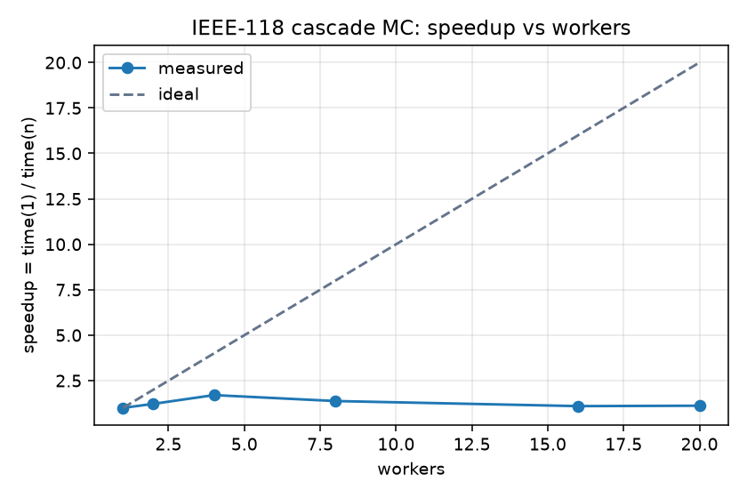

# grid-mimd — IEEE-118 cascade Monte Carlo, етап 1

Локальний MIMD-симулятор каскадних відмов IEEE-118 на `multiprocessing.Pool`.
Опис задачі: `cloud_grid/docs/n01_power_grid_project.md`. План: `my-grid-lab/docs/work/PLAN.md`.

| Файл | Що всередині |
| :--- | :--- |
| `engine.py` | Підготовка топології, `run_trial`, `simulate_trials_chunk`, `GridSimulationEngine` |
| `app.py` | `run_headless_benchmark`, графік speedup, CLI |
| `benchmark_results_mimd_grid.json` | Результат `--headless` |
| `speedup.png` | Speedup vs workers, створюється в `--headless` |
| `plots/` | Графіки даних обраного сценарію (`--viz`) |

## Результати

Сценарій `s = 83810` (випадковий з `--seed 42`), `N = 10 000` trials, `--shock weighted`, `--unrated-margin 2.0`, `--threshold 0.05`. Машина: `cpu_count() = 20`. Джерело: `benchmark_results_mimd_grid.json` (k = 1), `benchmark_results_mimd_grid_k2.json` (k = 2).

### P(blackout)

| `k` | `P(blackout)` | Trials з каскадом | Середній `dns_proxy` |
| :--- | :--- | :--- | :--- |
| **1** | **0.0000** (0 з 10 000) | 0.00% | 0.00006 |
| 2 | 0.0002 (2 з 10 000) | 0.18% | 0.00018 |

При `k = 1` мережа в цьому режимі витримує відмову будь-якої однієї лінії: каскад не стартує в жодному trial. Еталон датасету для цього `s` узгоджений: `dns_MW = 0`, `output_features = 0`.

### Throughput і speedup

| Workers | Час, с | Throughput, trials/s | Speedup | Efficiency | Послідовна частка `f` (Амдал) |
| :--- | :--- | :--- | :--- | :--- | :--- |
| 1 | 0.457 | 21 902 | 1.00 | 1.00 | — |
| 2 | 0.373 | 26 777 | 1.22 | 0.61 | 0.64 |
| **4** | **0.268** | **37 326** | **1.70** | 0.43 | 0.45 |
| 8 | 0.332 | 30 164 | 1.38 | 0.17 | 0.69 |
| 16 | 0.416 | 24 046 | 1.10 | 0.07 | 0.90 |
| 20 (`cpu_count`) | 0.408 | 24 517 | 1.12 | 0.06 | 0.89 |

`k = 1`. Для `k = 2` картина та сама: максимум 1.83× на 8 воркерах, 1.38× на 20.



**Коментар.** Speedup досягає максимуму 1.7× на 4 воркерах і далі падає. Throughput на 20 воркерах (24 517 trials/s) майже такий самий, як на одному (21 902).

- За законом Амдала `S(n) = 1 / (f + (1 − f)/n)`, де `f` — частка роботи, яку не можна розпаралелити. Якби `f` була сталою, speedup ріс би до межі `1/f` і не падав. Тут оцінка `f` росте з кількістю воркерів: 0.45 на 4 і 0.89 на 20. Отже, вузьке місце — не послідовна частина алгоритму, а накладні витрати, які ростуть разом із кількістю процесів.
- Таке накладне — це старт `Pool`. На Windows кожен воркер запускається через `spawn`: новий інтерпретатор Python заново імпортує `numpy`, `engine` і завантажувач датасету. Усі trials разом займають лише ~0.46 с, тож старт навіть кількох процесів займає помітну частину заміру.
- Передача даних вузьким місцем не є. Топологія після `pickle` важить 9 КБ на чанк, при 80 чанках це менше 1 МБ.
- Самі trials незалежні, без спільного стану й синхронізації. Тому вплив накладних витрат зменшиться зі зростанням `N` або якщо пул створювати один раз на весь бенчмарк, а не на кожен прогін (`SHARED_POOL` у `cloud_grid/source/mimd-pc/app.py`).

### Топ-3 найвразливіші лінії

Рейтинг — за `P(blackout | лінія в початковому шоку)`. При `k = 1` блекаутів 0, тож рейтинг порожній. Тому наведено `k = 2`:

| # | Гілка | Вузли | У шоку, разів | `P(blackout \| шок)` |
| :--- | :--- | :--- | :--- | :--- |
| 1 | 55 | 34–37 | 39 | 0.026 |
| 2 | 14 | 9–10 | 92 | 0.011 |
| 3 | 54 | 34–36 | 117 | 0.009 |

Рейтинг спирається лише на **2 блекаути з 10 000 trials**: кожна лінія з таблиці була в шоку в одному з них. Це вказівка на район мережі (вузол 34), а не стабільна оцінка. Щоб отримати статистично стійкий топ, потрібні більше `N` або стрес-режим `--unrated-margin 1.5`: на 1000 trials при `k = 1` він дав `P(blackout) = 0.003` і каскади у 3.7% trials.

## Підготовка

Структура тек (відносно `projects/`):

```text
cloud_grid/source/dataset_scripts/      # завантажувач і візуалізація курсу (імпортуються)
my-grid-lab/dataset/dataset_cascades/dataset_cascades/ieee118/ieee118/raw/*.mat
my-grid-lab/source/grid-mimd/           # цей проєкт
```

Датасет: `dataset_cascades.zip` з [PowerGraph на Figshare](https://figshare.com/articles/dataset/PowerGraph/22820534), розпакувати в `my-grid-lab/dataset/dataset_cascades/`.

Залежності (Windows PowerShell):

```powershell
cd my-grid-lab\source\grid-mimd
python -m venv .venv
.\.venv\Scripts\Activate.ps1
pip install numpy scipy h5py matplotlib networkx
```

`matplotlib` потрібен для `--headless` (speedup.png), `networkx` — лише для `--viz`.

## Запуск

```powershell
# швидка перевірка + графіки даних сценарію
python app.py --trials 1000 --workers 1 --viz

# звіт: k = 1 (обов'язково) і k = 2, ємність ліній без рейтингу m = 2.0 (default) і m = 1.5
python app.py --headless --trials 10000 --k 1
python app.py --headless --trials 10000 --k 2 --out benchmark_results_mimd_grid_k2.json
python app.py --headless --trials 10000 --k 1 --unrated-margin 1.5 --out benchmark_results_mimd_grid_m1.5.json
python app.py --headless --trials 10000 --k 2 --unrated-margin 1.5 --out benchmark_results_mimd_grid_k2_m1.5.json
```

`--headless` проганяє ті самі `N` trials з тим самим seed для `workers = 1, 2, 4, …, --workers` і пише JSON та `speedup.png` (для іншого `--out` — `<stem>_speedup.png`).

| Прапорець | Default | Сенс |
| :--- | :--- | :--- |
| `--headless` | off | Бенчмарк по кількості воркерів |
| `--trials` | `1000` | `N`; для звіту `≥ 10 000` |
| `--workers` | `cpu_count()` | Максимум воркерів |
| `--k` | `1` | Ліній у N-k шоку, `1…5` |
| `--data` | `my-grid-lab/dataset/dataset_cascades` | Батьківська тека внутрішньої `dataset_cascades` |
| `--out` | `benchmark_results_mimd_grid.json` | JSON бенчмарку |
| `--scenario` | випадковий з `--seed` | Індекс режиму `s` у датасеті |
| `--seed` | `42` | Seed вибору `s` і trials |
| `--threshold` | `0.05` | Поріг `dns_proxy` для blackout |
| `--shock` | `weighted` | `weighted` (`∝ flow/capacity`), `trunk` (кінець зі степенем ≥ 3), `uniform` |
| `--unrated-margin` | `2.0` | Ємність ліній з `lr <= 0`; `0` — правило n01 `max(1.0, 2·\|P_ij\|)` |
| `--viz` | off | PNG даних сценарію в `plots/` |

## Модель

Один trial — послідовний: N-k шок → перерозподіл потоку вимкнених ліній на активних сусідів пропорційно резерву `capacity − flow` → вимкнення найбільш перевантаженої лінії → повтор, доки є перевантаження (максимум 186 кроків). Паралельно виконуються незалежні trials (`Pool.map` по чанках).

Метрики: `P(blackout)`, середній `dns_proxy`, частка trials з каскадом, рейтинг ліній `P(blackout | лінія в шоку)` і кількість їх вимкнень у каскадах.

### Відхилення від n01 і обмеження

- **Шкала даних.** Ознаки PowerGraph нормалізовані в межах сценарію (`max − min = 1`, нуль — середнє). `dns_proxy` і «споживачі» (`P_net < 0`) — відносні величини в цій шкалі, не MW.
- **Ємність ліній без рейтингу.** n01 §2.5 задає `max(1.0, 2·|P_ij|)`. На нормалізованих даних поріг `1.0` дорівнює всьому розмаху потоків, і каскад стає неможливим: при перерозподілі пропорційно резерву сусід перевантажується лише тоді, коли потік вимкненої лінії більший за сумарний резерв усіх сусідів. Тому за замовчуванням `capacity = 2.0·|P_ij|` без порогу (`--unrated-margin`). Правило n01 — `--unrated-margin 0`.
- **Час** у бенчмарку включає старт `Pool` (на Windows воркери стартують через `spawn` і заново імпортують модулі).
